# Historical map provenance and 1900 boundary audit (M11c)

**Reference date:** 1 January 1900. The map is a historical reconstruction, not
a modern political map and not a survey. Approximate frontiers are labelled and
are not presented as exact.

## 1. Method

The map is built offline by `scripts/m11/build-map.mjs` from:

1. **Modern Natural Earth geometry as building blocks only.** The 1:50m
   admin-0 units provide the base coastlines and country blocks; the 1:10m
   admin-1 and admin-0 units provide reconstruction blocks (French departments,
   Polish voivodeships, Romanian counties, Indian states, Nigerian states,
   Chadian regions, etc.). A modern unit is never accepted as a 1900 border
   without an explicit historical claim.
2. **Authored 1900 transfers** in
   `packages/data/data/historical/m11/boundaries_1900.json`. Each transfer
   names its destination, its source polities, its source units or authored
   polygon, its dated sources, its confidence, and its known uncertainty.
3. **Source clipping.** Every transfer shape is intersected with its source
   polity's base geometry. This keeps the destination a subset of the modern
   source blocks and prevents a reconstruction from silently spilling across a
   generalized coastline.
4. **Topological cleanup.** Transfers are applied with `polygon-clipping`;
   residual destination/source overlaps are resolved deterministically (a
   transfer destination beats its source, otherwise the smaller, more specific
   polity keeps a sliver). The rings are simplified to 0.02° and quantized to
   0.001°.
5. **Audit.** `scripts/m11/audit-map.mjs` decodes the final bundle, rebuilds
   outer-ring/hole grouping, checks ring validity, computes pairwise overlaps,
   and samples land at 1° resolution for unassigned gaps. The report is
   `packages/data/data/map/world_map_1900_audit.json`.

### Confidence classes

- **HIGH** — supported by strong historical cartographic, administrative or
  treaty evidence; the only uncertainty is modern-source generalization.
- **MEDIUM** — reconstructed from reliable sources, with a frontier line or
  exact extent that remains uncertain.
- **LOW** — a defensible approximate historical extent where the evidence is
  incomplete or the frontier was not surveyed or defined.

### Geometry classes

- **direct-modern-verified** — one modern unit whose external border is documented as identical in 1900.
- **aggregate-modern-verified** — a union of modern units whose combined 1900 external border is documented as identical.
- **reconstructed** — the 1900 geometry differs from the modern map and is rebuilt with explicit transfers.
- **approximate** — a defensible but low-confidence historical extent.
- **marker-only** — no polygon. There are **no marker-only polities** in the
  final M11c map; the M11b marker entries were replaced with polygons.

### Coverage summary

| Measure | Count |
|---|---:|
| Catalogued polities | 133 |
| Map polities with provenance | 133 |
| Marker-only polities | 0 |
| Disputed map-only zones | 0 (resolved by current borders) |
| Disputed area (deg²) | 0 |
| Invalid rings | 0 |
| Overlaps above 0.001 deg² | 2 |
| Largest overlap (deg²) | 0.004 |
| Land samples (1°) | 15351 |
| Disputed 1° samples | 0 |
| Unassigned 1° samples | 26 |
| Unassigned components | 26 |
| Largest unassigned component | 1 sample(s) |
| Polygon-level unassigned area (deg²) | 4047.8074 |
| Intentional (Antarctica) area (deg²) | 4026.4191 |
| Generalization slivers (deg²) | 19.5504 |
| Unexplained small-island area (deg²) | 1.838 |

Geometry classes: **direct-modern-verified** 65, **aggregate-modern-verified** 20, **reconstructed** 37, **approximate** 11. Boundary confidence: **high** 73, **medium** 46, **low** 14.

## 2. Germany — the German Empire, not the Federal Republic

The modern German polygon is only a building block. The 1900 German Empire is
reconstructed by adding:

- **Alsace-Lorraine** — the French departments Bas-Rhin, Haut-Rhin and Moselle,
  annexed in 1871. Territoire de Belfort remained French and is excluded.
- **North Schleswig** — the modern Danish territory south of the Kongeå and
  north of the 1920 border.
- **Eupen-Malmedy** — the districts transferred to Belgium in 1920.
- **Memel (Klaipėda)** — the Klaipėda county, German until 1923.
- **East Prussia (Kaliningrad)** — the northern half of East Prussia, Russian
  from 1945.
- **Posen, West Prussia, Pomerania and Silesia** — the modern Polish
  voivodeships clipped to the authored 1900 German-Russian and German-Austrian
  frontier. The line excludes Congress Poland (Kalisz, Konin, Włocławek,
  Częstochowa) and Austrian Galicia, while retaining Thorn, Posen, Breslau and
  the East Prussian core. The frontier strip is generalized to roughly 10–20 km
  and carries MEDIUM confidence; the surrounding transfers are HIGH.

The result is tested with point-in-polygon checks for Berlin, Königsberg,
Danzig, Posen, Breslau, Strasbourg, Metz, Kiel, Flensburg, Memel, Eupen,
Tønder and Thorn (included), and Warsaw, Kalisz, Częstochowa, Włocławek,
Kraków, Vilnius, Copenhagen, Nancy, Belfort and Basel (excluded).

## 3. Libya — Ottoman Tripolitania, Cyrenaica and Fezzan

Libya was not a modern independent state in 1900. The territory was under
Ottoman sovereignty, administered as the vilayet of Tripoli (Tripolitania), the
sanjak of Benghazi (Cyrenaica) and the loosely administered Fezzan. M11c adds
the modern Libyan outer frame to the **Ottoman Empire (OTT)**. No `LBY` polity
is added, and no modern Libyan sovereign state is invented.

The map provenance records three Ottoman components:

- **Tripolitania** — Ottoman vilayet of Tripoli; coastal garrisons and limited
  interior control.
- **Cyrenaica** — Ottoman sanjak of Benghazi; the Senussi order exercised
  substantial local authority alongside the Ottoman administration.
- **Fezzan** — loosely administered mutasarrifate; effective control was shared
  with local and trans-Saharan authorities and the southern limit was not
  delimited.

The outer frame is MEDIUM confidence. The provincial and southern limits are
explicitly approximate; the distinction between sovereignty, local
administration and limited effective control is recorded rather than flattened
into a modern national border. Point tests cover Tripoli, Benghazi, Sabha,
Murzuq, Kufra and Ghadames, and the audit confirms there is no unassigned land
sample in the Libyan box. Tunisia, Egypt, French Algeria and Spanish Sahara
retain their own 1900 assignments.

## 3a. Aouzou–Tibesti: a disputed frontier, not FEA and not Ottoman Libya

M11c.1 corrects the earlier assignment of the Aouzou strip to French Equatorial
Africa. The 21 March 1899 Anglo-French Declaration defined a **sphere of
influence**, not an administered boundary; the ICJ's 1994 judgment treated it as
a line limiting the French zone and looked to later instruments (1919, 1902,
1955) to establish the modern boundary. None of those later instruments is
applied retroactively to 1 January 1900. France had not established continuous
administration across Tibesti; Ottoman authority was claimed and intermittently
projected; Toubou/Teda communities exercised the practical local authority. No
single power administered the whole zone continuously.

The area is excluded from **both OTT and FEA** and from every other polity. It is
a map-only `disputed-no-established-administration` zone with claims,
administration notes and sources. The rectangle approximates the Aouzou strip
(15–16°E) plus the Tibesti massif (16–19°E) north of 19.5°N, including Bardaï
and Gouro. It is an uncertainty zone, not a precise border.

A second small map-only zone, `siachen-kashmir`, records the undelimited
Karakoram–Siachen frontier between British India and Qing China in 1900. It is
not a playable polity and changes no simulation id.

South of the disputed zone, **Borkou and Ennedi** remain in the Wadai
sphere/proxy, **Bilma** remains in French West Africa, and central Chad remains
FEA. This preserves the difference between French claims, Ottoman claims, local
authority and the later colonial map.

## 4. Global boundary audit

Every catalogued polity is listed below. “Transfers” names the explicit
historical transfers that change its modern geometry; “—” means the modern
external outline was independently verified as the 1900 external border. The
notes state the historical deviation, the confidence limitation, or the reason
the modern outline is retained.

### Europe

| ID | Tag | Polity | Geometry | Confidence | Transfer(s) | Boundary notes and deviations from the modern map |
|---:|---|---|---|---|---|---|
| 1 | `GBR` | United Kingdom of Great Britain and Ireland | aggregate-modern-verified | high | — | The United Kingdom of Great Britain and Ireland in 1900 comprised the modern United Kingdom and the whole of Ireland. External borders are unchanged. |
| 2 | `DEU` | German Empire | reconstructed | medium | germany-alsace-lorraine, germany-north-schleswig, germany-eupen-malmedy, germany-east-prussia-kaliningrad, germany-memel, germany-prussian-east | Reconstructed as the 1900 German Empire: modern Germany plus Alsace-Lorraine, northern Schleswig, Eupen-Malmedy, KlaipÄ—da, Kaliningrad and the Prussian eastern provinces, clipped to the 1900 Russian/Austrian frontier. The eastern frontier strip is the least certain part. |
| 3 | `FRA` | French Republic | reconstructed | high | germany-alsace-lorraine | Modern France minus Alsace-Lorraine (Bas-Rhin, Haut-Rhin, Moselle). Belfort remained French and is retained. |
| 4 | `RUS` | Russian Empire | reconstructed | medium | germany-east-prussia-kaliningrad, germany-memel, germany-prussian-east, austria-galicia, austria-cieszyn, russia-kars, khiva-from-russia, bukhara-from-russia | The Russian Empire in 1900 included the Baltic provinces, Belarus, most of Ukraine, Bessarabia, Congress Poland, Finland (separate grand duchy), the Caucasus, Central Asia and Kars/Ardahan/Artvin. German Poland, KlaipÄ—da, Galicia, Khiva and Bukhara are removed; Kars is added. |
| 6 | `ITA` | Kingdom of Italy | reconstructed | high | austria-south-tyrol, austria-littoral | Modern Italy minus Trentino/South Tyrol, Trieste and Gorizia, which were Austrian in 1900. |
| 7 | `ESP` | Kingdom of Spain | direct-modern-verified | high | — | Peninsular Spain and the Balearics were unchanged between 1900 and the modern outline; the African possessions are separate territories. |
| 8 | `PRT` | Kingdom of Portugal | direct-modern-verified | high | — | Peninsular Portugal was unchanged; the Azores and Madeira are included in the modern outline and were Portuguese in 1900. |
| 9 | `NLD` | Kingdom of the Netherlands | direct-modern-verified | high | — | The European Netherlands external border was unchanged in 1900. The East Indies, Suriname and Caribbean islands are separate territories. |
| 10 | `BEL` | Kingdom of Belgium | reconstructed | high | germany-eupen-malmedy | Modern Belgium minus Eupen-Malmedy, annexed from Germany in 1920. |
| 11 | `CHE` | Swiss Confederation | direct-modern-verified | high | — | The Swiss Confederation's external border was unchanged in 1900. |
| 12 | `SWE` | Kingdom of Sweden | direct-modern-verified | high | — | Sweden's external border was unchanged in 1900; the personal union with Norway is a separate polity. |
| 13 | `NOR` | Kingdom of Norway | direct-modern-verified | high | — | Norway's external border was unchanged in 1900. Svalbard was terra nullius until 1920 but is included in the modern Norwegian outline; this is a known small over-assignment. |
| 14 | `DNK` | Kingdom of Denmark | reconstructed | high | germany-north-schleswig | Modern Denmark minus North Schleswig, German from 1864 to 1920. |
| 15 | `GRC` | Kingdom of Greece | reconstructed | medium | greece-ottoman-new-lands, greece-dodecanese, crete-autonomous | The 1900 Kingdom of Greece comprised the Peloponnese, Attica, Thessaly (from 1881), the Ionian Islands, Euboea, the Cyclades and part of southern Epirus. Epirus, Macedonia, Thrace, the North Aegean and the Dodecanese are removed to the Ottoman Empire; Crete is separate. |
| 16 | `SRB` | Kingdom of Serbia | reconstructed | high | austria-vojvodina, serbia-sandzak | The 1900 Kingdom of Serbia excluded Vojvodina (Austria-Hungary) and the Sandžak (Ottoman). Both are removed. |
| 17 | `MNT` | Principality of Montenegro | reconstructed | high | austria-kotor, montenegro-sandzak | The 1900 Principality of Montenegro excluded the Bay of Kotor (Austrian) and the Sandžak municipalities acquired in 1912-13. |
| 18 | `ROM` | Kingdom of Romania | reconstructed | high | austria-bukovina, austria-transylvania, bulgaria-south-dobruja | The 1900 Kingdom of Romania comprised Wallachia and Moldavia plus northern Dobruja. Transylvania, the Banat, Crișana, Maramureș and southern Bukovina are removed to Austria-Hungary; southern Dobruja is added from Bulgaria. |
| 19 | `BGR` | Principality of Bulgaria | reconstructed | high | bulgaria-south-dobruja | The 1900 Principality of Bulgaria included Eastern Rumelia but not southern Dobruja, which was Romanian until 1913. |
| 21 | `LUX` | Grand Duchy of Luxembourg | direct-modern-verified | high | — | The Grand Duchy's external border was unchanged in 1900. |
| 22 | `MCO` | Principality of Monaco | direct-modern-verified | high | — | Monaco's 1861 border was unchanged in 1900. |
| 23 | `SMR` | Most Serene Republic of San Marino | direct-modern-verified | high | — | San Marino's border was unchanged in 1900. |
| 24 | `AND` | Co-Principality of Andorra | direct-modern-verified | high | — | Andorra's border was unchanged in 1900. |
| 25 | `LIE` | Principality of Liechtenstein | direct-modern-verified | high | — | Liechtenstein's border was unchanged in 1900. |
| 60 | `AUT` | Austro-Hungarian Monarchy | reconstructed | high | austria-galicia, austria-bukovina, austria-transylvania, austria-vojvodina, austria-kotor, austria-south-tyrol, austria-littoral, austria-cieszyn | Austria-Hungary in 1900 comprised modern Austria, Hungary, Czechia, Slovakia, Slovenia, Croatia, Bosnia and Galicia, plus Transylvania, the Banat, Vojvodina, South Tyrol, Trieste, Gorizia, Kotor and Cieszyn Silesia. Those areas are added from Russia, Romania, Serbia, Montenegro, Italy and Poland. |
| 66 | `CRT` | Cretan State | direct-modern-verified | high | crete-autonomous | The Cretan State's 1900 territory is the island of Crete, matching the modern Greek region. |
| 106 | `CYP` | Cyprus | aggregate-modern-verified | high | — | Cyprus was a British protectorate from 1878; the modern island outline (including the north) is correct. |
| 107 | `MLT` | Malta | direct-modern-verified | high | — | Malta's borders were unchanged in 1900. |
| 121 | `ALG` | Algeria | direct-modern-verified | low | — | French Algeria's 1900 southern boundary was not effectively administered beyond the Tell and the northern Sahara; the modern Algerian outline is a rough approximation. The Hoggar and Touat were not fully controlled until 1902-05. |
| 154 | `ISL` | Iceland | direct-modern-verified | high | — | Iceland was a Danish dependency in 1900; the modern outline is correct. |
| 155 | `GRL` | Greenland | direct-modern-verified | high | — | Greenland was a Danish colony in 1900; the modern outline is correct. |
| 156 | `FRO` | Faroe Islands | direct-modern-verified | high | — | The Faroe Islands were a Danish dependency in 1900; the modern outline is correct. |
| 160 | `FIN` | Grand Duchy of Finland | reconstructed | medium | — | The Grand Duchy of Finland in 1900 included the Karelian Isthmus, Ladoga Karelia, Salla and Petsamo, which modern Finland lost to the USSR, and excluded Petsamo (acquired 1920). The modern Finnish outline is used as a base; the eastern cessions are not reconstructed. This is a known under-representation. |

### Asia

| ID | Tag | Polity | Geometry | Confidence | Transfer(s) | Boundary notes and deviations from the modern map |
|---:|---|---|---|---|---|---|
| 5 | `JPN` | Empire of Japan | direct-modern-verified | high | — | The Japanese home islands in 1900 (Honshu, Hokkaido, Kyushu, Shikoku, Okinawa and the Bonins) match the modern outline. Taiwan is a separate colony and Korea is independent. |
| 20 | `OTT` | Ottoman Empire | reconstructed | medium | russia-kars, serbia-sandzak, montenegro-sandzak, greece-ottoman-new-lands, greece-dodecanese, libya-ottoman, yemen-aden-british, shammar-from-ottoman | The Ottoman Empire in 1900 included Anatolia, the Levant, Iraq, the Hejaz, Yemen, Albania, Macedonia and Kosovo, plus Libya. Kars/Ardahan/Artvin are Russian; northern Najd is Jabal Shammar; southern Yemen is British; Crete is autonomous. |
| 26 | `CHN` | Qing Empire | reconstructed | medium | tibet-from-china | The Qing Empire in 1900 included modern China, Manchuria, Xinjiang, Mongolia and Tibet. Tibet is separated as an autonomous province; Taiwan is Japanese; Hong Kong and Macao are separate. The Tibetan and Mongolian internal frontiers are not drawn. |
| 27 | `KOR` | Korean Empire | aggregate-modern-verified | high | — | The Korean Empire comprised the modern Korean peninsula (Republic of Korea and DPRK). External borders are unchanged. |
| 28 | `PER` | Sublime State of Persia | direct-modern-verified | medium | — | Persia's external border was broadly the modern Iranian outline. The Ottoman-Persian frontier in Kurdistan and Khuzestan was not fully delimited until 1913-37; minor frontier strips are approximate. |
| 29 | `AFG` | Emirate of Afghanistan | direct-modern-verified | medium | — | Afghanistan's external border after the 1893 Durand Line matches the modern outline. The northern frontier with Russia was fixed in the 1880s-90s. |
| 30 | `NPL` | Kingdom of Nepal | direct-modern-verified | high | — | Nepal's external border was unchanged in 1900. |
| 31 | `THA` | Kingdom of Siam | reconstructed | medium | siam-cambodian-provinces, siam-laotian-provinces, siam-malay-states | Siam in 1900 included the western Cambodian provinces ceded in 1904-07, Sainyabuli, and the northern Malay states transferred to British protection in 1909. Those areas are added. |
| 32 | `OMN` | Sultanate of Muscat and Oman | reconstructed | medium | oman-gwadar | Muscat and Oman included Gwadar on the Makran coast until 1958. Gwadar is added from British India. |
| 65 | `SHM` | Emirate of Jabal Shammar (Ha'il) | approximate | medium | shammar-from-ottoman | Jabal Shammar is reconstructed from Ha'il, Qassim, Riyadh, the Northern Borders and al-Jowf. Ottoman sovereignty over Najd was nominal; the desert frontiers are approximate. |
| 100 | `BIN` | British India | reconstructed | medium | yemen-aden-british, portuguese-india, french-india, oman-gwadar | British India in 1900 included modern India, Pakistan, Bangladesh and Burma, plus Aden. Goa/Daman/Diu, French India and Gwadar are removed; the Andamans, Nicobars, Lakshadweep and Sikkim are retained. The Burmese and frontier administrations are not separately drawn. |
| 101 | `CEY` | Ceylon | reconstructed | high | ceylon-maldives | Ceylon in 1900 was the modern Sri Lanka; the Maldives were a separate protectorate and are removed. |
| 102 | `MAL` | British Malaya and Singapore | reconstructed | medium | siam-malay-states, malaya-sarawak | British Malaya in 1900 comprised the Federated and Unfederated Malay States, Singapore and Brunei, but not Sarawak, North Borneo or the northern Malay states (Siamese until 1909). Sarawak is separate; the northern states are removed to Siam. North Borneo remains grouped here as a British-protected territory. |
| 103 | `HKG` | Hong Kong | direct-modern-verified | high | — | Hong Kong in 1900 included Hong Kong Island, Kowloon and the New Territories leased in 1898; the modern outline is correct. |
| 105 | `TRU` | Trucial States | aggregate-modern-verified | medium | — | The Trucial States and Bahrain were British-protected; the modern UAE and Bahrain outlines approximate the 1900 coastal principalities. The interior boundaries were not delimited. |
| 125 | `FIC` | French Indochina | reconstructed | medium | siam-cambodian-provinces, siam-laotian-provinces, french-india | French Indochina in 1900 comprised Tonkin, Annam, Cochinchina, Cambodia and Laos. The western Cambodian and Lao provinces ceded by Siam in 1904-07 are removed; French India is grouped here as a map aggregation. |
| 142 | `MAC` | Macao | direct-modern-verified | high | — | Macao's 1900 territory was the Macao peninsula and the islands; the modern outline is correct. |
| 145 | `DEI` | Dutch East Indies | direct-modern-verified | low | — | The Dutch East Indies in 1900 comprised the modern Indonesian archipelago, but Dutch New Guinea was only nominally claimed and not effectively administered. The modern outline is retained with this caveat. |
| 150 | `PHL` | Philippine Islands | aggregate-modern-verified | medium | — | The Philippine Islands were a United States territory in 1900; the modern archipelago is correct. The Sulu Sultanate's residual authority and the Moro resistance are not shown as separate polities. |
| 159 | `BHU` | Bhutan | direct-modern-verified | high | — | Bhutan's external border was unchanged after the 1865 Duar War settlement. |
| 161 | `TWN` | Taiwan (Formosa) | direct-modern-verified | high | — | Taiwan was a Japanese colony from 1895; the modern island outline is correct. |
| 162 | `TIB` | Tibet | approximate | low | tibet-from-china | Tibet is reconstructed from the modern Tibet Autonomous Region only. Amdo (Qinghai) and Kham (Sichuan/Yunnan) are not separated; the polygon is a conservative core. |
| 163 | `KHI` | Khanate of Khiva | approximate | low | khiva-from-russia | The Khanate of Khiva is approximated by Xorazm, Karakalpakstan and DaÅŸoguz. The desert frontier was not a hard line. |
| 164 | `BUK` | Emirate of Bukhara | approximate | low | bukhara-from-russia | The Emirate of Bukhara is approximated by Bukhara, Navoiy, Qashqadaryo, Surxondaryo, Khatlon, Dushanbe and the Republican Subordination districts. The Pamir and desert frontiers are uncertain. |
| 165 | `SAR` | Raj of Sarawak | direct-modern-verified | high | malaya-sarawak | The Raj of Sarawak's 1900 territory matches the modern Malaysian state of Sarawak. |

### Africa

| ID | Tag | Polity | Geometry | Confidence | Transfer(s) | Boundary notes and deviations from the modern map |
|---:|---|---|---|---|---|---|
| 33 | `ETH` | Ethiopian Empire | direct-modern-verified | medium | — | The Ethiopian Empire's 1900 outline is broadly the modern one after Menelik II's expansion. The western and southern frontier zones were not surveyed; the modern outline is a defensible approximation. |
| 34 | `LBR` | Republic of Liberia | direct-modern-verified | low | — | Liberia's 1900 boundary was larger than the modern one: France annexed frontier districts in 1892 and 1911. The modern outline is retained as a conservative de facto extent; the loss is not reconstructed. |
| 35 | `MAR` | Sultanate of Morocco | direct-modern-verified | low | — | Morocco's 1900 southern and south-eastern frontier was not delimited. The modern outline excludes the Tindouf/Colomb-Béchar claims and Western Sahara (separate Spanish territory); the modern border is a rough approximation. |
| 36 | `ZAR` | South African Republic (Transvaal) | approximate | low | — | The Transvaal is approximated by the modern Gauteng, North West, Mpumalanga and Limpopo provinces. The 1900 republic's border differed from the modern provincial boundaries, especially in the west and south. |
| 37 | `ORF` | Orange Free State | approximate | low | — | The Orange Free State is approximated by the modern Free State province. The 1900 republic's western boundary and the Basutoland border differed from the modern province. |
| 62 | `SOK` | Sokoto Caliphate | approximate | low | sokoto-from-british-west-africa | The Sokoto Caliphate's core is reconstructed from ten modern northern Nigerian states. The frontier was a shifting military boundary; the southern and eastern emirates are not all included. |
| 63 | `WAD` | Sultanate of Wadai | approximate | low | wadai-from-french-equatorial-africa | The Wadai Sultanate's core is reconstructed from six modern Chadian regions. The northern Tibesti and southern tributary zones are excluded; no surveyed 1900 border exists. |
| 64 | `DAR` | Sultanate of Darfur | approximate | medium | darfur-from-anglo-egyptian-sudan | The Darfur Sultanate is reconstructed from the five modern Darfur states. The 1900 sultanate was somewhat larger, especially toward Kordofan; the modern states are a conservative core. |
| 104 | `KUW` | Kuwait | direct-modern-verified | medium | — | Kuwait was a British protectorate from 1899; its 1900 borders were not delimited. The modern outline is a rough approximation. |
| 110 | `BWA` | British West Africa | aggregate-modern-verified | medium | togo-volta, sokoto-from-british-west-africa | British West Africa in 1900 comprised Gambia, Sierra Leone, the Gold Coast and Nigeria. The Volta Region is removed to German Togo; northern Nigeria is removed to Sokoto. The grouping is a map aggregation. |
| 111 | `BEA` | British East Africa | aggregate-modern-verified | medium | italian-somaliland-jubaland | British East Africa in 1900 comprised the East Africa Protectorate and Uganda, plus Jubaland. The modern Kenya/Uganda outlines approximate the 1900 protectorates; Jubaland is added from Italian Somaliland. |
| 112 | `SUD` | Anglo-Egyptian Sudan | reconstructed | high | darfur-from-anglo-egyptian-sudan | Anglo-Egyptian Sudan in 1900 excluded Darfur, which was independent after 1898. Darfur is removed. |
| 113 | `BSO` | British Somaliland | reconstructed | medium | italian-somaliland-british | British Somaliland is reconstructed from the northwest Somali regions, approximating the 1894 Anglo-Italian frontier. |
| 114 | `CRA` | British Central Africa | aggregate-modern-verified | medium | — | British Central Africa in 1900 comprised Nyasaland, Northern Rhodesia and Southern Rhodesia. The modern Malawi/Zambia/Zimbabwe outlines are close; the grouping is a map aggregation. |
| 115 | `HCT` | High Commission Territories | aggregate-modern-verified | high | — | The High Commission Territories were Basutoland, Bechuanaland and Swaziland, matching modern Lesotho, Botswana and Eswatini. |
| 118 | `CAP` | Cape Colony | approximate | medium | german-south-west-africa-walvis | The Cape Colony is approximated by the modern Northern Cape, Western Cape and Eastern Cape provinces, plus Walvis Bay. The 1900 colonial boundary differed from the modern provincial lines, especially on the eastern frontier and in Griqualand. |
| 119 | `NAT` | Natal | approximate | medium | — | Natal is approximated by the modern KwaZulu-Natal province. The 1900 colony included Zululand (annexed 1897); the modern province is close but not identical. |
| 122 | `TUN` | Tunisia | direct-modern-verified | high | — | The French protectorate of Tunisia's borders were unchanged after 1881. |
| 123 | `FWA` | French West Africa | aggregate-modern-verified | medium | — | French West Africa in 1900 comprised Senegal, French Sudan, Guinea, Ivory Coast, Dahomey, Mauritania and the Niger military territory. The modern outlines are close; Upper Volta did not exist until 1919. The grouping is a map aggregation. |
| 124 | `FEA` | French Equatorial Africa | aggregate-modern-verified | medium | wadai-from-french-equatorial-africa | French Equatorial Africa in 1900 comprised Congo, Gabon, Ubangi-Shari and Chad. Wadai is removed as an independent sultanate. The modern outlines are close. |
| 126 | `MAD` | French Madagascar | aggregate-modern-verified | high | — | French Madagascar and the Comoros were French in 1900; the modern outlines are correct. |
| 127 | `FSO` | French Somaliland | direct-modern-verified | high | — | French Somaliland's 1900 border was broadly the modern Djibouti outline. |
| 130 | `GEA` | German East Africa | reconstructed | medium | german-east-africa-zanzibar, german-east-africa-kionga | German East Africa in 1900 comprised Tanganyika, Rwanda, Burundi and the Kionga triangle, but not Zanzibar and Pemba. Zanzibar is removed to the British group; Kionga is added from Mozambique. |
| 131 | `GSW` | German South West Africa | reconstructed | high | german-south-west-africa-walvis | German South West Africa in 1900 excluded Walvis Bay, a British Cape enclave. Walvis Bay is removed. |
| 132 | `KAM` | Kamerun | direct-modern-verified | low | — | Kamerun's 1900 borders were smaller than the 1911 Neukamerun and did not include the later French Congo cessions. The modern Cameroon outline is a rough approximation; the Chad/CAR frontier and the Bakassi area are uncertain. |
| 133 | `TOG` | Togo | reconstructed | high | togo-volta | German Togo in 1900 included the Volta Region, which is added from the Gold Coast. The modern Togolese outline is otherwise correct. |
| 137 | `CFS` | Congo Free State | direct-modern-verified | medium | — | The Congo Free State in 1900 covered the modern DRC. The external border was broadly the modern one; the eastern and southern frontiers were not fully surveyed. |
| 138 | `ANG` | Portuguese Angola | direct-modern-verified | medium | — | Portuguese Angola in 1900 included Cabinda and the modern Angolan outline. The eastern frontier with the Congo Free State and Northern Rhodesia was not fully demarcated until the 20th century. |
| 139 | `MOZ` | Portuguese Mozambique | reconstructed | high | german-east-africa-kionga | Portuguese Mozambique in 1900 included the Kionga triangle, which is removed to German East Africa. The modern outline is otherwise correct. |
| 140 | `PAI` | Portuguese Atlantic islands | reconstructed | medium | portuguese-india | The Portuguese colonial grouping includes Cape Verde, São Tomé and Príncipe, Portuguese Guinea and Portuguese India (Goa, Daman, Diu). Portuguese India was a separate colony; grouping it here is a map aggregation. |
| 143 | `ERI` | Italian Eritrea | direct-modern-verified | high | — | Italian Eritrea's 1900 borders were the modern Eritrean outline after the 1889-1900 delimitations. |
| 144 | `ITS` | Italian Somaliland | reconstructed | medium | italian-somaliland-british, italian-somaliland-jubaland | Italian Somaliland in 1900 excluded British Somaliland and Jubaland. British Somaliland is removed to the British protectorate; Jubaland is removed to British East Africa. |
| 148 | `SAH` | Spanish Sahara | direct-modern-verified | medium | — | Spanish Sahara's 1900 coastal and northern boundary was established by the 1884-1900 agreements; the eastern and southern limit with French West Africa was not fully delimited. The modern Western Sahara outline is a rough approximation. |
| 149 | `SGG` | Spanish Guinea | direct-modern-verified | high | — | Spanish Guinea (Rio Muni and Fernando Pó) matches the modern Equatorial Guinea mainland and Bioko; Annobón was also Spanish. |
| 158 | `EGY` | Egypt | direct-modern-verified | medium | — | Egypt was an autonomous Ottoman province under British occupation in 1900. The modern Egyptian outline is close; the Sudan condominium and the Hala'ib frontier are not shown separately. |

### Americas

| ID | Tag | Polity | Geometry | Confidence | Transfer(s) | Boundary notes and deviations from the modern map |
|---:|---|---|---|---|---|---|
| 0 | `USA` | United States of America | direct-modern-verified | high | — | The 1900 United States external border (including Alaska and the annexed Hawaiian Islands) coincides with the modern Natural Earth outline. The Philippines, Puerto Rico, Guam and American Samoa are separate territories. |
| 38 | `MEX` | United Mexican States | direct-modern-verified | high | — | Mexico's external border was unchanged after 1853; Quintana Roo was administered as part of Yucatán in 1900 but is Mexican territory. |
| 39 | `GUA` | Republic of Guatemala | direct-modern-verified | medium | — | Guatemala's external border with Mexico was fixed in 1882 and with British Honduras in 1859-1931; the modern outline is a close approximation. |
| 40 | `HON` | Republic of Honduras | direct-modern-verified | medium | — | Honduras's borders with Nicaragua and El Salvador were settled in the early 20th century; the modern outline is a close approximation. |
| 41 | `SAL` | Republic of El Salvador | direct-modern-verified | high | — | El Salvador's external border was unchanged in 1900. |
| 42 | `NIC` | Republic of Nicaragua | direct-modern-verified | medium | — | Nicaragua's borders with Honduras and Costa Rica were settled in 1906-15; the modern outline is a close approximation. |
| 43 | `COS` | Republic of Costa Rica | direct-modern-verified | medium | — | Costa Rica's border with Panama (then Colombian) was settled in 1900-01; the modern outline is a close approximation. |
| 44 | `COL` | Republic of Colombia | aggregate-modern-verified | high | — | Colombia in 1900 included Panama; the union of modern Colombia and Panama is the correct 1900 extent. |
| 45 | `VEN` | United States of Venezuela | direct-modern-verified | medium | — | Venezuela's de facto border with British Guiana followed the Schomburgk line; the modern outline is close but the Essequibo claim was larger. |
| 46 | `ECU` | Republic of Ecuador | direct-modern-verified | low | — | Ecuador's 1900 claim to the Oriente was much larger than the modern outline; the de facto Amazonian frontier was contested with Peru. The modern outline is a conservative approximation. |
| 47 | `PRU` | Republic of Peru | reconstructed | high | chile-tacna | Peru in 1900 did not include Tacna, which was under Chilean administration until 1929. Tacna is removed. |
| 48 | `BOL` | Republic of Bolivia | reconstructed | medium | bolivia-acre | Bolivia in 1900 included Acre, acquired by Brazil in 1903; Acre is added and the Treaty of Petrópolis is not applied retroactively. The Chaco Boreal was disputed with Paraguay and is left with Paraguay as the de facto administration, not a recognized sovereignty. A residual proxy-boundary sliver with Brazil is trimmed and recorded. |
| 49 | `CHL` | Republic of Chile | reconstructed | high | chile-tacna | Chile in 1900 administered Tacna and Arica after the War of the Pacific. Tacna is added; Arica is already in the modern Chilean outline. |
| 50 | `ARG` | Argentine Republic | direct-modern-verified | high | — | Argentina's external border with Chile was settled in 1881-1902; the modern outline is the 1900 extent. |
| 51 | `URY` | Oriental Republic of Uruguay | direct-modern-verified | high | — | Uruguay's borders were unchanged in 1900. |
| 52 | `PRY` | Republic of Paraguay | direct-modern-verified | low | — | Paraguay's 1900 Chaco frontier was disputed and largely unadministered. The modern Chaco is shown as de facto Paraguayan; this is an explicit uncertainty, not a recognized 1900 border. |
| 53 | `BRA` | Republic of the United States of Brazil | reconstructed | medium | bolivia-acre | Brazil in 1900 did not include Acre, which was Bolivian until 1903. Acre is removed; the Treaty of Petrópolis is not applied retroactively. A residual proxy-boundary sliver with Bolivia is trimmed and recorded. |
| 54 | `HTI` | Republic of Haiti | direct-modern-verified | high | — | Haiti's border was unchanged in 1900. |
| 55 | `DOM` | Dominican Republic | direct-modern-verified | high | — | The Dominican Republic's border was unchanged in 1900. |
| 56 | `CAN` | Dominion of Canada | reconstructed | high | newfoundland-from-canada | The Dominion of Canada in 1900 excluded Newfoundland and Labrador, which are removed. The modern provincial boundaries are used; northern Quebec and the territories were administered by Canada. |
| 59 | `CUB` | Republic of Cuba under United States occupation | direct-modern-verified | high | — | Cuba's border was unchanged; the island was under United States military occupation in January 1900. |
| 108 | `BWI` | British West Indies | aggregate-modern-verified | medium | — | The British West Indies grouping aggregates the British Caribbean colonies and British Honduras. Individual colonial boundaries were largely unchanged; the grouping is a map aggregation. |
| 109 | `BSA` | British South Atlantic and Pacific islands | aggregate-modern-verified | medium | — | The British South Atlantic and Pacific islands grouping aggregates the Falklands, South Georgia, St Helena, Pitcairn and the British Indian Ocean Territory. BIOT (Chagos) was administered from Mauritius in 1900; the grouping is a map aggregation. |
| 120 | `NFD` | Newfoundland | reconstructed | medium | newfoundland-from-canada | Newfoundland and Labrador were a separate dominion in 1900. The modern province is used as the polygon, but the Labrador interior boundary was disputed around 1900; the 1927 Privy Council line is not treated as an uncontested 1900 border. A residual coastline sliver is trimmed and recorded in the overlap audit. |
| 128 | `FCA` | French Caribbean | aggregate-modern-verified | high | — | The French Caribbean grouping (Guiana, Guadeloupe, Martinique, St Pierre and Miquelon, St Barthélemy, St Martin) was French in 1900. |
| 146 | `SUR` | Suriname | direct-modern-verified | high | — | Suriname's 1900 border was the modern one after the 1891 arbitration. |
| 147 | `DGC` | Dutch Caribbean | aggregate-modern-verified | high | — | The Dutch Caribbean islands (Aruba, Curaçao, Sint Maarten, Bonaire, Saba, Sint Eustatius) were Dutch in 1900. |
| 151 | `PRI` | Puerto Rico | direct-modern-verified | high | — | Puerto Rico was a United States territory in 1900; the modern outline is correct. |
| 157 | `DWI` | Danish West Indies | direct-modern-verified | high | — | The Danish West Indies (now the US Virgin Islands) were Danish in 1900; the modern island outlines are correct. |

### Oceania

| ID | Tag | Polity | Geometry | Confidence | Transfer(s) | Boundary notes and deviations from the modern map |
|---:|---|---|---|---|---|---|
| 57 | `AUS` | Australian colonies | aggregate-modern-verified | high | — | The six Australian colonies in 1900 covered the modern Australian mainland and Tasmania. Federation occurred on 1 January 1901; the map shows the colonies as one 1900 dominion. |
| 58 | `NZL` | Colony of New Zealand | direct-modern-verified | high | — | New Zealand's 1900 borders were the modern ones. The Cook Islands, Niue and other Pacific dependencies are separate territories. |
| 61 | `TON` | Kingdom of Tonga | direct-modern-verified | high | tonga-from-british-pacific | The Kingdom of Tonga's 1900 territory is the modern Tongan archipelago. It was a British protected state, not a colony. |
| 116 | `FJI` | Fiji | direct-modern-verified | high | — | Fiji's 1900 borders were the modern archipelago. |
| 117 | `BPO` | British Pacific and Indian Ocean islands | reconstructed | medium | ceylon-maldives, german-east-africa-zanzibar, german-new-guinea-papua, tonga-from-british-pacific, niue-british-protectorate | The British Pacific and Indian Ocean grouping includes the Solomon Islands, Gilbert and Ellice Islands, Cook Islands, Niue, Norfolk Island, New Hebrides, Mauritius, Seychelles, Maldives, Zanzibar/Pemba and British New Guinea. Tonga is separate. Some of these were protectorates or condominia, not colonies; the grouping is a map aggregation. |
| 129 | `FPO` | French Pacific | aggregate-modern-verified | high | french-southern-territories | The French Pacific grouping (French Polynesia, New Caledonia, Wallis and Futuna, plus the French Southern Territories) was French in 1900. The southern Indian Ocean islands were administered from Madagascar; the grouping is a map aggregation. |
| 134 | `GNG` | German New Guinea | reconstructed | medium | german-new-guinea-papua | German New Guinea in 1900 comprised the northern mainland (Kaiser-Wilhelmsland), the Bismarck Archipelago and Bougainville, but not British New Guinea (Papua). The southern Papuan provinces are removed to the British group; the 1885 boundary is approximated. |
| 135 | `GSA` | German Samoa | direct-modern-verified | high | — | German Samoa comprised the modern independent Samoa (Western Samoa); American Samoa was a separate US territory. |
| 136 | `GPN` | German Pacific islands | aggregate-modern-verified | high | — | The German Pacific islands (Marshall, Caroline, Palau, Northern Marianas, Nauru) were German in 1900; the modern island outlines are correct. |
| 141 | `PTM` | Portuguese Timor | direct-modern-verified | high | — | Portuguese Timor's 1900 border with the Dutch East Indies was the modern East Timor outline. |
| 152 | `GUM` | Guam | direct-modern-verified | high | — | Guam was a United States territory in 1900; the modern outline is correct. |
| 153 | `ASM` | American Samoa | direct-modern-verified | high | — | American Samoa was a United States territory in 1900; the modern outline is correct. |

## 4a. Visual smoke images

The committed comparison images are rendered from the map bundle with
`scripts/m11/render_map.py` (Miller projection, even-odd rings). They are
smoke/comparison artefacts, not survey maps.

| View | Before M11c | After M11c |
|---|---|---|
| Entire world | 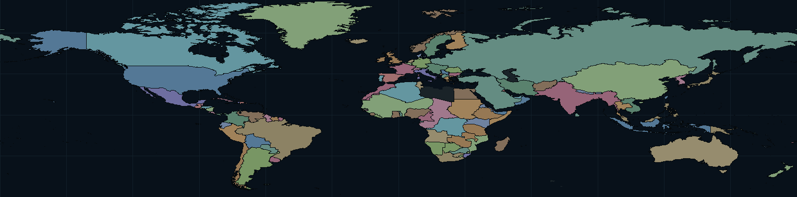 | 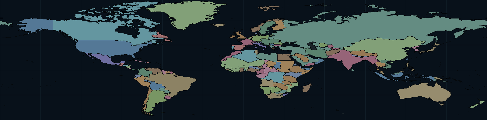 |
| Europe | 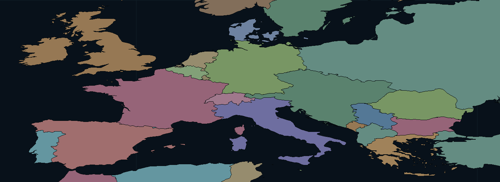 | 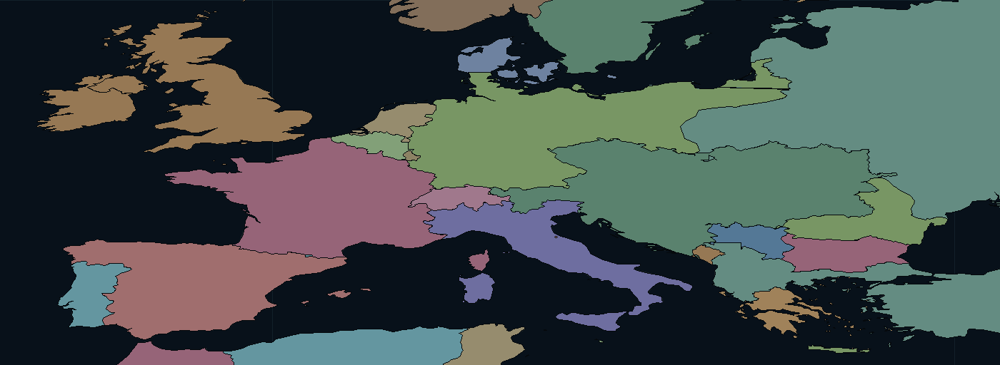 |
| German Empire | 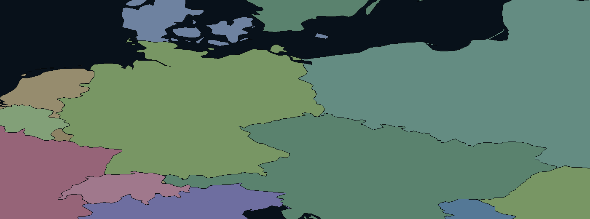 | 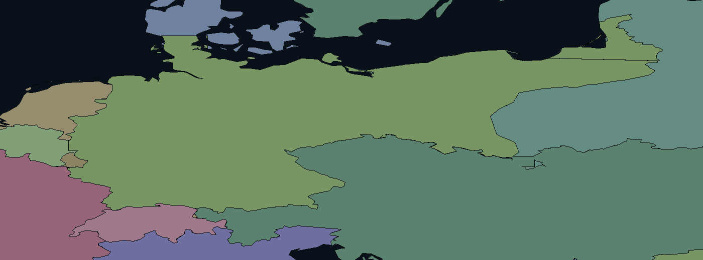 |
| North Africa | 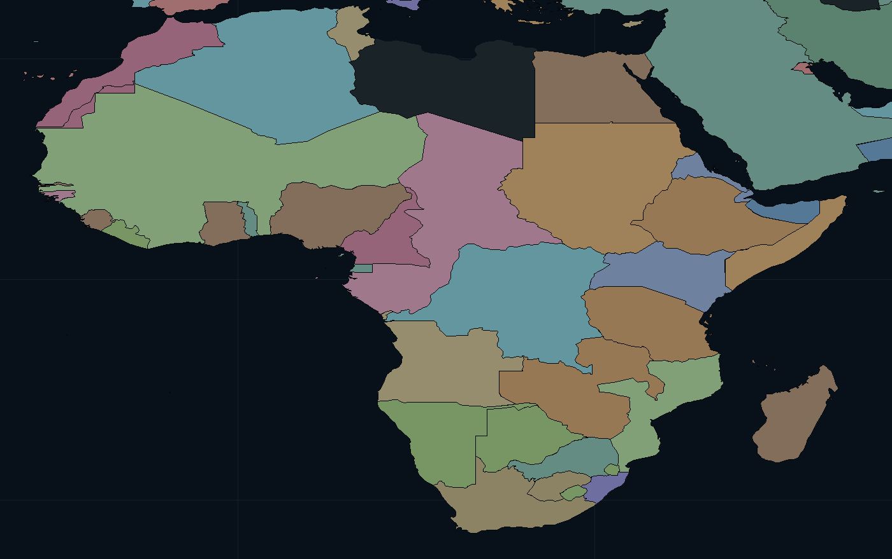 | 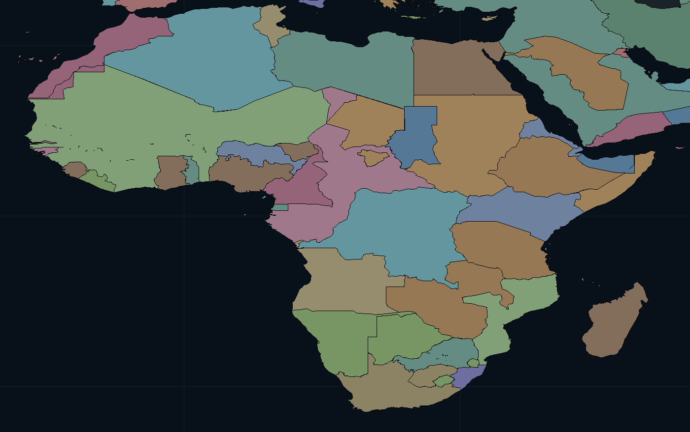 |
| Libya / Ottoman North Africa | — | 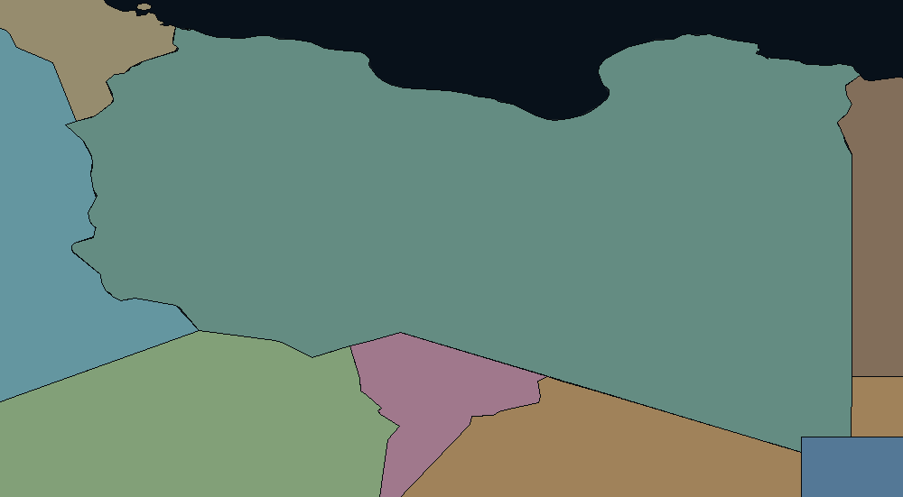 |
| Central Asia | — | 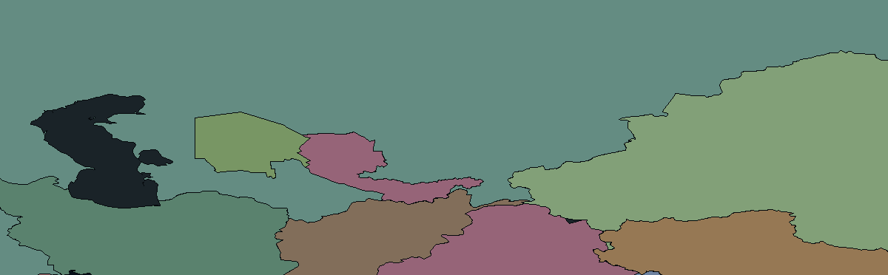 |
| Global at previous max zoom (10) | — | 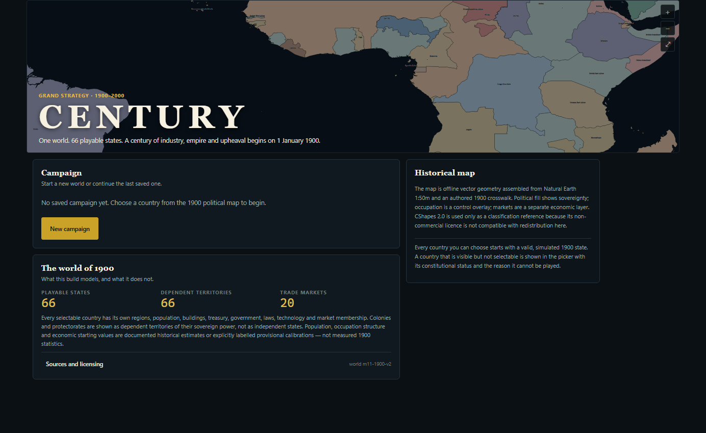 |
| Europe wheel-zoom (regional clarity) | — | 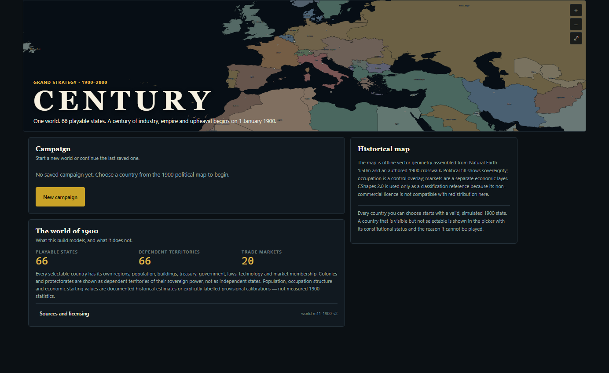 |
| Global at new max zoom (18) | — | 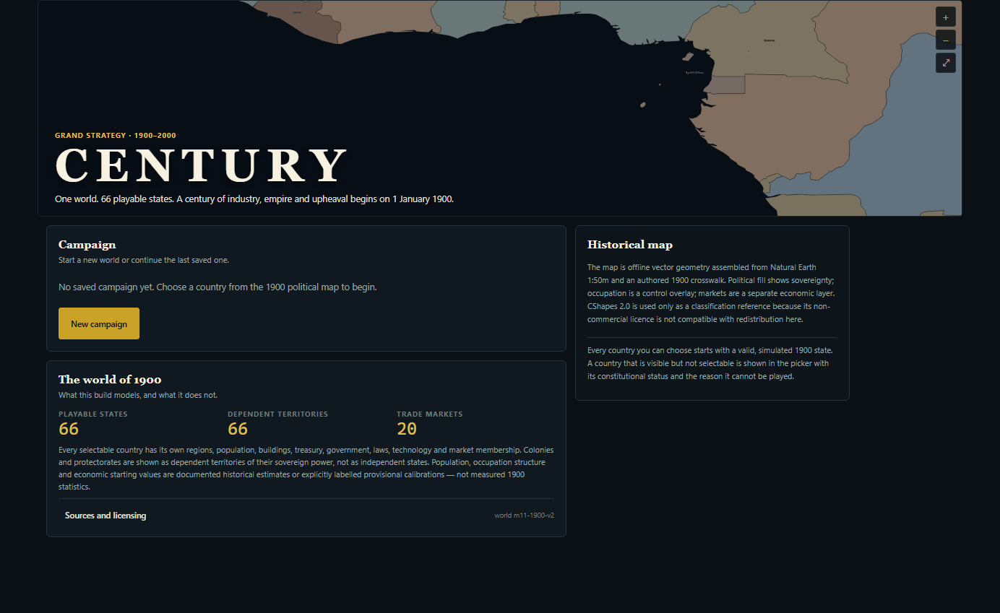 |
| Zoom/pan ocean check (no stale land) | — | 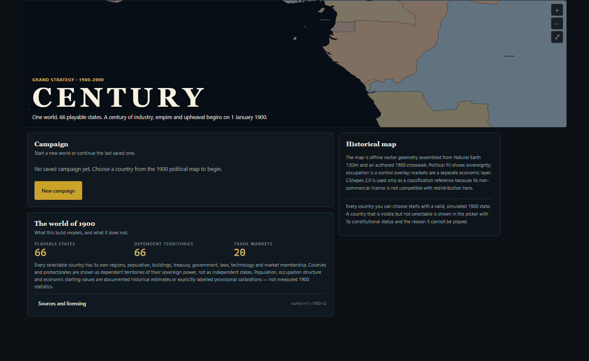 |
| Aouzou–Tibesti disputed zone | — | 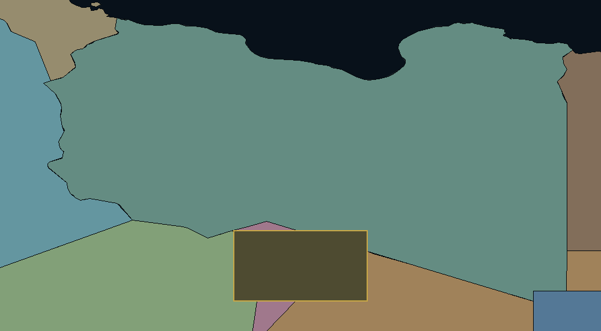 |
| Bolivia–Brazil / Acre | — | 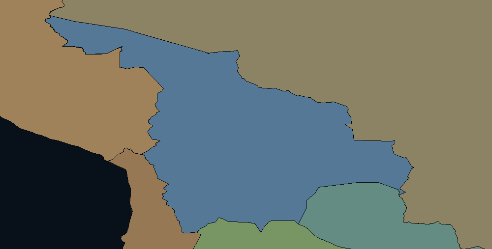 |
| Canada–Newfoundland / Labrador | — | 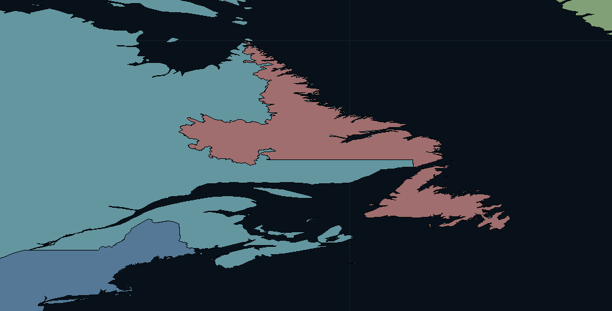 |

The before images are the pre-M11c bundle at the same projection and bounds. The
Libyan black void in the before image is the gap M11c closes; the German before
image is the modern Federal Republic outline, while the after image is the 1900
German Empire.

## 5. Why some modern borders are retained

A modern border is retained only where the research establishes that the 1900
external border coincided with it. Examples:

- **United Kingdom** — Great Britain and the whole of Ireland; no external
  change between 1900 and the modern outline used here.
- **Spain, Portugal, Switzerland, the Netherlands, Luxembourg, Monaco, San
  Marino, Andorra and Liechtenstein** — peninsular/European external borders
  unchanged; colonial possessions are separate entries.
- **Sweden and Norway** — separate polities in personal union; their external
  borders were unchanged in 1900.
- **United States** — the 1900 external border includes Alaska and the annexed
  Hawaiian Islands; the Philippines, Puerto Rico, Guam and American Samoa are
  separate territories.
- **Japan** — the home islands, Okinawa and the Bonins; Taiwan is a separate
  colony and Korea is independent.
- **Mexico, Argentina, Uruguay, Haiti and the Dominican Republic** — external
  borders unchanged after the relevant 19th-century settlements; micro-frontier
  uncertainty is recorded in the notes.

Retaining a modern outline in these cases is an explicit verification result,
not a default. Polities whose modern territory contains a documented 1900
difference are reconstructed (Germany, France, Denmark, Belgium, Italy,
Austria-Hungary, Russia, the Ottoman Empire, Romania, Bulgaria, Serbia,
Montenegro, Greece, Siam, British India, the African colonies, China/Tibet,
the Central Asian protectorates and the Americas/Oceania entries above).

## 5a. Canada–Newfoundland and Bolivia–Brazil overlaps

The M11c audit reported two overlaps. M11c.1 extracted each intersection,
recorded its coordinates and area, and trimmed only the shared sliver from the
loser; the historical boundary notes are retained:

- **CAN / NFD** — before 0.249 deg² at bbox -64.822, 46.803, -52.88, 60.373. trimmed from the loser; winner keeps the shared area. The Labrador interior boundary was disputed around 1900; the 1927 Privy Council line is not applied retroactively. This sliver is a modern-proxy coastline/geometry artefact, not the disputed interior boundary itself. Canada keeps the modern provincial outline as a geometric proxy, with the dispute recorded in provenance.
- **BRA / BOL** — before 0.016 deg² at bbox -73.974, -11.06, -66.726, -7.343. trimmed from the loser; winner keeps the shared area. Acre was Bolivian in 1900. The 1903 Treaty of Petrópolis and the 1903-04 demarcation are not applied retroactively. This sliver is an artefact of using the modern Acre/Brazil proxy boundary, not a deliberate post-1903 cession.
- **RUS / BUK** — before 0.002 deg² at bbox 62.028, 36.969, 70.299, 43.481. trimmed from the loser; winner keeps the shared area. The Bukhara protectorate boundary is a modern administrative proxy; this sub-0.005 deg² sliver is a geometry artefact, not a historical claim.

The Labrador interior boundary was disputed around 1900 and the 1927 Privy
Council line is not treated as an uncontested 1900 border. The modern province
outline is used only as a geometric proxy. Acre was Bolivian in 1900; the 1903
Treaty of Petrópolis and the 1903–04 demarcation are not applied retroactively.
The residual components are sub-0.01 deg² and recorded by the audit; no
post-1903 cession or 1927 adjudication is silently applied.

## 5b. Former disputed map-only zones (resolved)

- **Aouzou–Tibesti frontier zone** (`aouzou-tibesti`, disputed-no-established-administration, low) — 14 deg² at bbox 15, 19.5, 19, 23. No single power exercised continuous effective administration across the whole zone on 1 January 1900. French posts and columns did not control Tibesti; Ottoman authority was claimed and intermittently projected; local Toubou authority was the most direct administration.
- **Karakoram–Siachen frontier zone** (`siachen-kashmir`, disputed-frontier-unsettled, low) — 1.04 deg² at bbox 76.6, 35, 77.9, 35.8. No surveyed or effectively administered boundary existed in the high Karakoram in 1900.

M11d follow-up (DECISIONS D-100) resolves both zones into ordinary territory:
the rectangles are split along current Natural Earth admin-0 borders and assigned
to the 1900 polities. Aouzou–Tibesti becomes Ottoman Libya (northern edge),
French Equatorial Africa (Chad/Aouzou/Tibesti) and French West Africa (Niger
edge); Karakoram–Siachen becomes British India (Siachen/India/Pakistan) and Qing
China. The split lines are a cartographic choice for a definite border, not a
surveyed 1900 frontier. `disputedAreas` is empty and `resolvedDisputes` records
the modern-to-1900 mapping; there is no disputed overlay, label or legend row.

## 6. Residual generalization artefacts

The audit reports **2** residual overlaps above 0.001 deg²
(largest 0.004 deg²) and **26**
unassigned 1° land samples. The polygon-level audit separates:

- **4026.4191 deg² intentionally unassigned** —
  Antarctica, outside the 1900 polity system.
- **19.5504 deg² of coastline/island
  generalization slivers** below 0.02 deg² each.
- **1.838 deg² in
  62 small-island/coastal components
  at or above 0.02 deg²** — 1:50m base-geometry detail gaps (for example Arctic
  islands and the Madagascar coast), not missing polities. The largest is
  534.9472 deg². They are
  retained as explicit uncertainty rather than filled with invented borders.

Residual overlaps:

- `CAN` / `NFD`: 0.004 deg² — a generalized-coastline sliver, not a deliberate political claim.
- `RUS` / `FIN`: 0.001 deg² — a generalized-coastline sliver, not a deliberate political claim.

Unassigned samples (each is a single 1° sample; there is no multi-sample
terrestrial void):

- 1 sample(s) near 131.5,-11.5 to 131.5,-11.5 — a 1-degree coastal/island sample, not a missing polity.
- 1 sample(s) near 12.5,-5.5 to 12.5,-5.5 — a 1-degree coastal/island sample, not a missing polity.
- 1 sample(s) near 44.5,1.5 to 44.5,1.5 — a 1-degree coastal/island sample, not a missing polity.
- 1 sample(s) near -77.5,5.5 to -77.5,5.5 — a 1-degree coastal/island sample, not a missing polity.
- 1 sample(s) near 121.5,15.5 to 121.5,15.5 — a 1-degree coastal/island sample, not a missing polity.
- 1 sample(s) near -91.5,18.5 to -91.5,18.5 — a 1-degree coastal/island sample, not a missing polity.
- 1 sample(s) near 66.5,25.5 to 66.5,25.5 — a 1-degree coastal/island sample, not a missing polity.
- 1 sample(s) near -75.5,35.5 to -75.5,35.5 — a 1-degree coastal/island sample, not a missing polity.
- 1 sample(s) near 41.5,41.5 to 41.5,41.5 — a 1-degree coastal/island sample, not a missing polity.
- 1 sample(s) near 143.5,42.5 to 143.5,42.5 — a 1-degree coastal/island sample, not a missing polity.
- 1 sample(s) near -2.5,47.5 to -2.5,47.5 — a 1-degree coastal/island sample, not a missing polity.
- 1 sample(s) near -68.5,48.5 to -68.5,48.5 — a 1-degree coastal/island sample, not a missing polity.
- 1 sample(s) near -126.5,50.5 to -126.5,50.5 — a 1-degree coastal/island sample, not a missing polity.
- 1 sample(s) near -3.5,50.5 to -3.5,50.5 — a 1-degree coastal/island sample, not a missing polity.
- 1 sample(s) near -9.5,51.5 to -9.5,51.5 — a 1-degree coastal/island sample, not a missing polity.
- 1 sample(s) near -85.5,55.5 to -85.5,55.5 — a 1-degree coastal/island sample, not a missing polity.
- 1 sample(s) near -157.5,57.5 to -157.5,57.5 — a 1-degree coastal/island sample, not a missing polity.
- 1 sample(s) near 10.5,57.5 to 10.5,57.5 — a 1-degree coastal/island sample, not a missing polity.
- 1 sample(s) near 151.5,59.5 to 151.5,59.5 — a 1-degree coastal/island sample, not a missing polity.
- 1 sample(s) near -71.5,63.5 to -71.5,63.5 — a 1-degree coastal/island sample, not a missing polity.
- 1 sample(s) near -108.5,67.5 to -108.5,67.5 — a 1-degree coastal/island sample, not a missing polity.
- 1 sample(s) near -22.5,71.5 to -22.5,71.5 — a 1-degree coastal/island sample, not a missing polity.
- 1 sample(s) near -81.5,76.5 to -81.5,76.5 — a 1-degree coastal/island sample, not a missing polity.
- 1 sample(s) near 100.5,76.5 to 100.5,76.5 — a 1-degree coastal/island sample, not a missing polity.
- 1 sample(s) near -80.5,80.5 to -80.5,80.5 — a 1-degree coastal/island sample, not a missing polity.
- 1 sample(s) near -16.5,80.5 to -16.5,80.5 — a 1-degree coastal/island sample, not a missing polity.

The Libyan gap that motivated M11c is gone. The Aouzou–Tibesti and
Karakoram–Siachen zones are represented explicitly as disputed, not left as
unexplained voids. Antarctica remains on the neutral land layer by design.

## 7. Sources

- **natural-earth-50m** — Natural Earth 1:50m cultural vectors (admin-0 and selected admin-1). Public domain. 2024. <https://www.naturalearthdata.com/downloads/50m-cultural-vectors/>
- **natural-earth-10m-admin1** — Natural Earth 1:10m admin-1 states and provinces. Public domain. 2024. <https://www.naturalearthdata.com/downloads/10m-cultural-vectors/10m-admin-1-states-provinces/>
- **natural-earth-10m-admin0** — Natural Earth 1:10m admin-0 countries. Public domain. 2024. <https://www.naturalearthdata.com/downloads/10m-cultural-vectors/10m-admin-0-countries/>
- **eb1911-germany** — Encyclopaedia Britannica (1911), 'Germany' and 'Prussia'. Public domain. 1911. <https://en.wikisource.org/wiki/1911_Encyclop%C3%A6dia_Britannica/Germany>
- **eb1911-tripoli** — Encyclopaedia Britannica (1911), 'Tripoli' and 'Cyrenaica'. Public domain. 1911. <https://en.wikisource.org/wiki/1911_Encyclop%C3%A6dia_Britannica/Tripoli>
- **eb1911-darfur** — Encyclopaedia Britannica (1911), 'Darfur'. Public domain. 1911. <https://en.wikisource.org/wiki/1911_Encyclop%C3%A6dia_Britannica/Darfur>
- **eb1911-wadai** — Encyclopaedia Britannica (1911), 'Wadai'. Public domain. 1911. <https://en.wikisource.org/wiki/1911_Encyclop%C3%A6dia_Britannica/Wadai>
- **hammond-1912** — Hammond's Modern Atlas of the World (1912). Public domain. 1912. <https://archive.org/details/hammondsmodernat00hamm>
- **times-atlas-1920** — The Times Survey Atlas of the World (1920), historical political sheets. Public domain. 1920. <https://archive.org/details/timessurveyatla00lond>
- **karte-deutsches-reich-1900** — Karte Deutsches Reich, Verwaltungsgliederung 1900-01-01 (Wikimedia Commons). Public domain. 1900. <https://commons.wikimedia.org/wiki/File:Karte_Deutsches_Reich,_Verwaltungsgliederung_1900-01-01.png>
- **reichsgesetzblatt-1871** — Reichsgesetzblatt 1871, Treaty of Frankfurt boundary annexations. Public domain. 1871. <https://de.wikisource.org/wiki/Friede_von_Frankfurt>
- **treaty-versailles-1919** — Treaty of Versailles (1919), territorial clauses. Public domain. 1919. <https://en.wikisource.org/wiki/Treaty_of_Versailles>
- **treaty-saint-germain-1919** — Treaty of Saint-Germain (1919), Austro-Hungarian territorial clauses. Public domain. 1919. <https://en.wikisource.org/wiki/Treaty_of_Saint-Germain-en-Laye>
- **treaty-trianon-1920** — Treaty of Trianon (1920), Hungarian territorial clauses. Public domain. 1920. <https://en.wikisource.org/wiki/Treaty_of_Trianon>
- **treaty-lausanne-1923** — Treaty of Lausanne (1923), Ottoman successor boundaries. Public domain. 1923. <https://en.wikisource.org/wiki/Treaty_of_Lausanne>
- **anglo-egyptian-sudan-1899** — Anglo-Egyptian Condominium Agreement (1899). Public domain. 1899. <https://en.wikisource.org/wiki/Anglo-Egyptian_Condominium_Agreement>
- **icj-libya-chad-1994** — ICJ, Territorial Dispute (Libyan Arab Jamahiriya/Chad), Judgment of 3 February 1994. ICJ public documents; quotation and citation only. 1994. <https://www.icj-cij.org/case/83>
- **icj-libya-chad-pleadings** — ICJ, Territorial Dispute (Libya/Chad), written pleadings and oral records, 1991-1993. ICJ public documents; citation only. 1991-1993. <https://www.icj-cij.org/case/83/written-proceedings>
- **labrador-boundary-dispute** — Labrador boundary dispute and the 1927 Privy Council reference. Reference only (not redistributed). 1927. <https://www.thecanadianencyclopedia.ca/en/article/labrador-boundary-dispute>
- **treaty-petropolis-1903** — Treaty of Petrópolis between Bolivia and Brazil (1903). Public domain. 1903. <https://en.wikisource.org/wiki/Treaty_of_Petr%C3%B3polis>
- **british-aden-1839** — British Aden and the Aden Protectorate, 1839-1900. Public domain. 1911. <https://en.wikisource.org/wiki/1911_Encyclop%C3%A6dia_Britannica/Aden>
- **historical-basemaps-1900** — historical-basemaps world_1900 (cross-check only). GPL-3.0 (not redistributed). 2018. <https://github.com/aourednik/historical-basemaps>
- **cshapes-2.0** — CShapes 2.0 (classification reference only). CC BY-NC-SA 4.0 (not redistributed). 2019. <https://icr.ethz.ch/data/cshapes/>
- **project-authored-1900** — Fabric of Nations M11c authored boundary reconstruction. Project data. 2026. <internal:packages/data/data/historical/m11/boundaries_1900.json>

## 8. Reproducing the audit

```bash
node scripts/m11/build-boundaries.mjs
node scripts/m11/build-map.mjs
node scripts/m11/audit-map.mjs
node scripts/m11/generate-provenance-doc.mjs
pnpm -F @century/tests test -- m11c-geography
```

The build cache (`.cache-m11/`) contains the one-time Natural Earth downloads;
the committed map bundle and audit report are fully offline and are the only
runtime artifacts.
