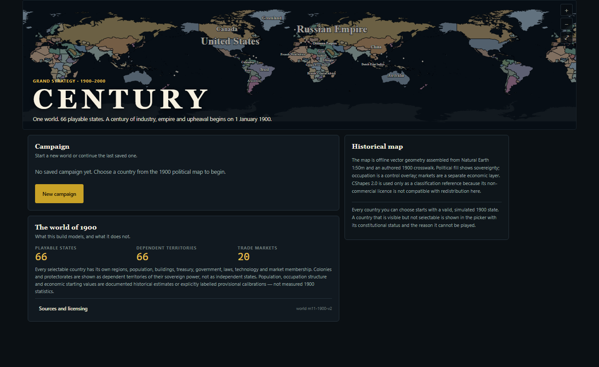
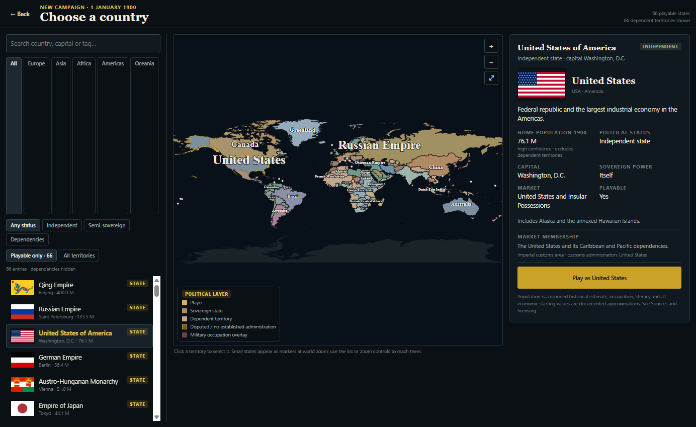
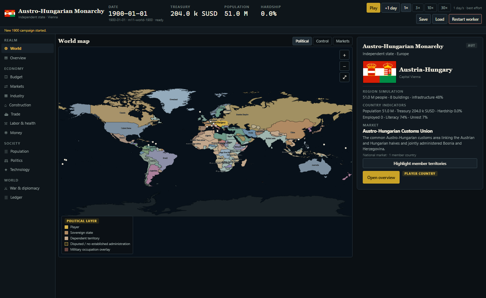
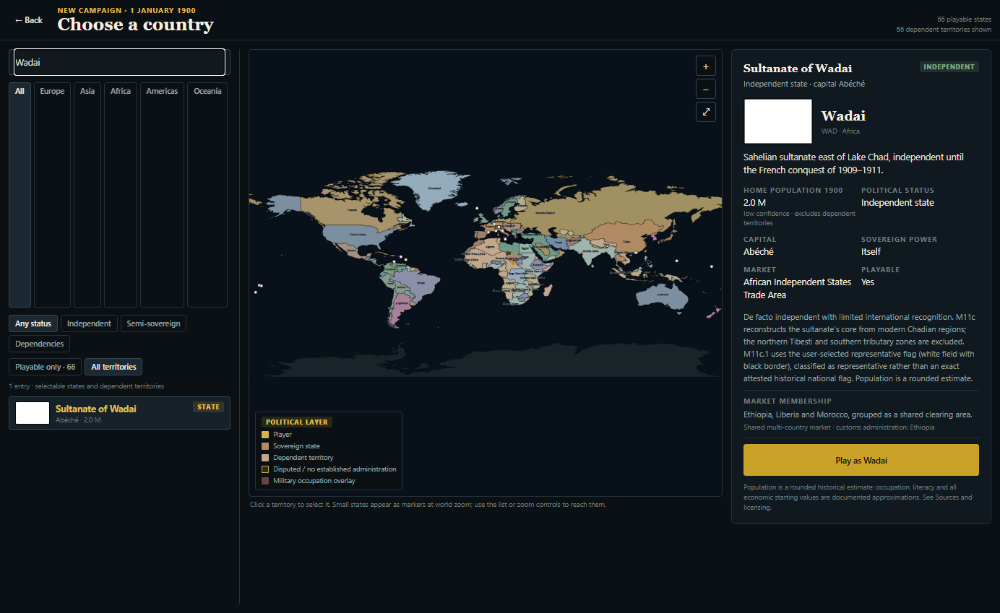
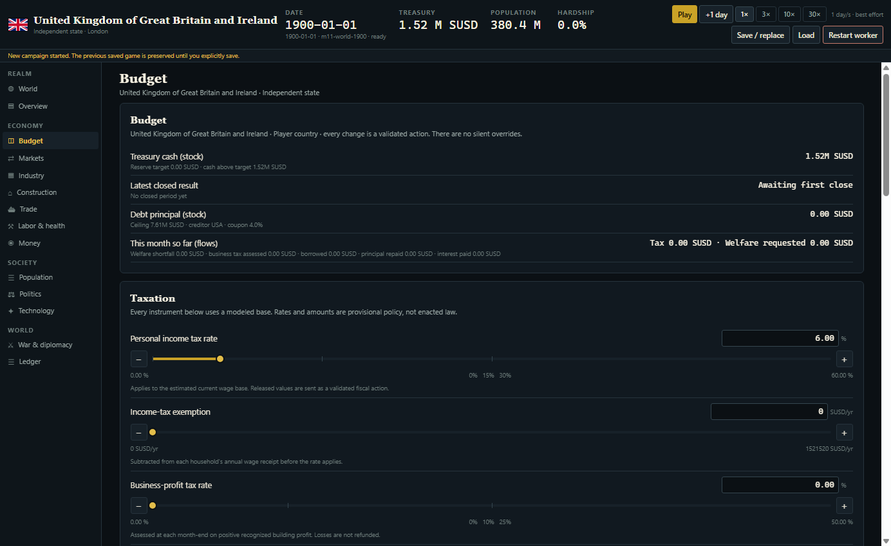
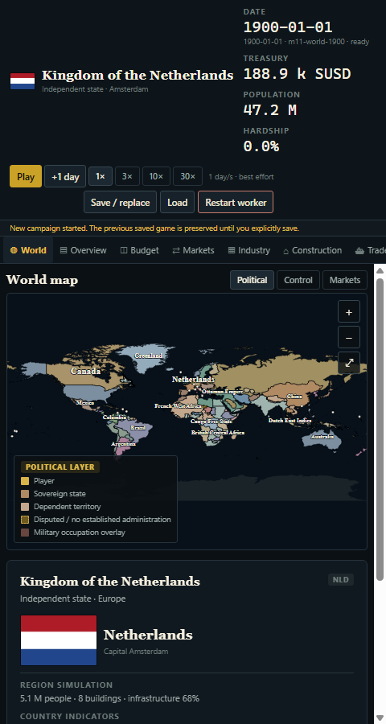
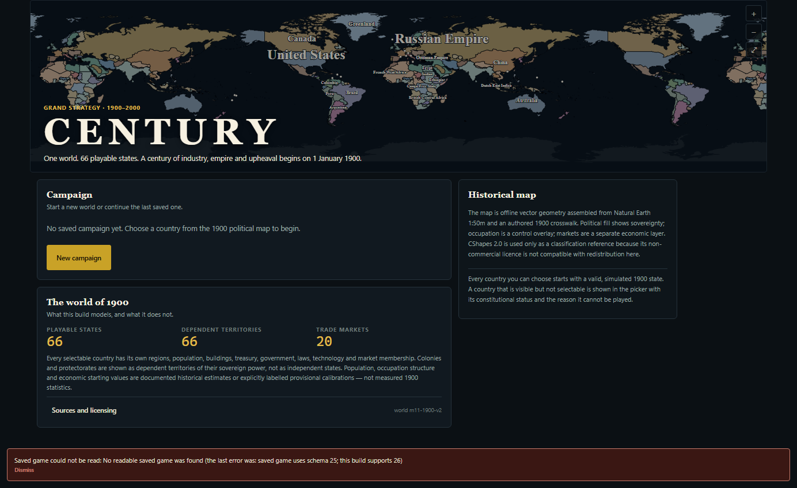

# M11d — Full runtime playtest, console error investigation and bug fixing

Milestone: **M11d** (QA and bug fixing; no new gameplay).
Baseline: M11c.1 committed at `aa59e7f` ("fix: correct Aouzou, overlaps, map rendering and zoom").
This report records the runtime playtest of the exported Expo web build, the
errors found in the real browser, the fixes, the regression tests and the
remaining limitations.

## 1. Runtime environment

| Item | Value |
|---|---|
| Host | Windows 11 Pro 10.0.26200, AMD Ryzen 5 2600, 7.9 GB RAM |
| Runtime | Node.js 24.22.1, pnpm 9.15.9 |
| Application | `@century/app` 0.3.0, Expo 58.0.19, React 19.3.0, React Native 0.88.0, react-native-web 0.21.4 |
| Browser | Google Chrome 156.0.8078.74, `--headless=new`, viewport 1400×1000 (plus 480×900 emulation) |
| Build | `pnpm -F @century/app export:web` → `packages/app/dist-web` (static export, no dev server) |
| Server | Local static HTTP server on `http://127.0.0.1:8877` from `scripts/m11d/lib/harness.mjs` |
| Automation | Chrome DevTools Protocol over WebSocket: `Runtime.consoleAPICalled`, `Runtime.exceptionThrown`, `Log.entryAdded`, `Network.responseReceived`, `Network.loadingFailed`, `Page.captureScreenshot`, `Input.dispatch*`, `Emulation.setDeviceMetricsOverride` |
| Simulation instrumentation | `Worker` constructor and `postMessage` wrapped by an injected script to count worker creations and record every command type/payload |
| Playtest driver | `scripts/m11d/playtest.mjs` (`--only=<scenario>`, `--fresh`) |
| Performance measurement | `scripts/m11d/measure-world-performance.mjs`, `scripts/m11d/measure-validation-cost.mjs` |

Launch commands used:

```bash
pnpm -F @century/app export:web
node scripts/m11d/playtest.mjs --fresh
node scripts/m11d/playtest.mjs --only=map --fresh
```

### Environment limitations

- **No native runtime was exercised.** Windows cannot run an iOS simulator;
  the installed Android SDK has no runnable AVD or emulator binary. The native
  provider path was hardened and typechecked, but no device build was launched.
- **No physical touch device.** Mouse, mouse-wheel and keyboard were exercised.
  Two-finger pinch and trackpad pinch could not be produced by CDP; their code
  paths share the pure focal-point zoom math covered by unit tests.
- **No screen reader.** ARIA attributes were verified in the DOM; no NVDA/
  VoiceOver session was run.
- **No network-offline test at the asset level.** The build is offline by
  construction (bundled geometry and bundled flag PNGs); the test server is
  local. Every asset request was inspected and no runtime fetch of map or flag
  data was observed.

## 2. Playtesting coverage

### Screens exercised

- Main menu, Sources & licensing modal (open, scroll, close), new-game brief.
- Country selection: search, continent chips, status filters (`Any status`,
  `Independent`, `Semi-sovereign`, `Dependencies`), `Playable only` / `All
  territories`, full 133-entry list, detail panel, dependency blocked panel.
- Game shell: World map, Overview, Budget, Markets, Industry, Construction,
  Trade, Labor & health, Money, Population, Politics, Technology, War &
  diplomacy, Ledger (all 14 navigation entries).
- Markets card → **Highlight members on the map** → World map market layer.
- Save / replace dialog, overwrite prompt, Continue campaign, Load without a
  save, Restart worker, error banners and their dismissal.
- Responsive layout at 480×900 (world + budget), then restored.

### Gameplay scenarios

- Startup with no save; startup with an existing save; startup with a
  legacy-schema save; startup with a corrupt stored save; clearing storage.
- Campaign creation for **Austria-Hungary, United States, Japan, Germany,
  United Kingdom, Brazil, Ethiopia, Netherlands, San Marino, Russia** (ten
  campaigns across Europe, Asia, Africa, the Americas and a microstate).
- Simulation: 5× `+1 day`, 8 s at 30×, pause/resume, rapid speed switching
  (30×/10×/3×/1×), 20 s at 30×, repeated save/load.
- Economy/government: treasury, latest closed result, debt principal and
  coupon, income tax, exemption, business-profit tax, welfare budget and
  ceiling, reserve target, borrow/repay, outstanding ceiling; slider step,
  numeric entry, drag, out-of-range clamp and non-numeric input.
- Map: global view, 9× zoom-in to maximum (scale 18), wheel zoom, pan, reset,
  hover over Europe/Africa/South America/Central Asia, selection of Germany,
  Libya (Ottoman Tripolitania) and British India, Political/Control/Markets
  layers, market-member highlight, rapid wheel/pan stress.
- Save/load: manual save, overwrite confirmation, reload, Continue, date and
  country preservation, save after advancing, three save/load cycles, restart
  worker three times.
- Country catalog edge cases: **Wadai, Darfur, Andorra, Liechtenstein, San
  Marino, Tonga** (playable), **British India** (dependency), Austria-Hungary
  (personal-union candidate / independent by catalog), all 133 flag images.

### Screens reviewed

All screenshots are in `docs/images/m11d/`; the main ones are:









## 3. Error inventory

All entries were reproduced in the running application before being fixed and
were re-tested afterwards in the same scenario.

| # | Error | Severity | Reproduction | Root cause | Fix | Regression test |
|---|---|---|---|---|---|---|
| 1 | Completing a save silently rebuilt the simulation worker and reset the campaign to day 0; status changed to "New campaign started. The previous saved game is preserved…". Worker count went from 1 to 2. No console message. | **CRITICAL** (silent progress loss / state corruption) | Create a campaign, advance to `1900-01-06`, play at 30× for 8 s, pause (triggers autosave). Date returned to `1900-01-01`; recorded commands: `SAVE` → `REQUEST_SNAPSHOT` → `CREATE_GAME`. A manual Save did the same. | `handleEvent` closed over `savedCampaign` state (`useCallback(..., [savedCampaign, setRunningState])`). The web/native worker-effect dependency lists included the handler identities, so `SAVE_RESULT → setSavedCampaign` re-ran the effect: it disposed the worker, created a new one and the provider replayed `CREATE_GAME` for the same player country from the initial world. | Saved-campaign envelope mirrored into `savedCampaignRef`; supervisor callbacks dispatch through handler refs; worker lifecycle depends only on `[webEpoch]` / `[nativeEpoch]`. | `packages/tests/src/m11d-provider-lifecycle.test.ts`; playtest checks "running does not reset the campaign", "no worker replacement while running", "no worker replacement during save/load cycles". |
| 2 | United Kingdom campaign could not start. Error banner: `event.snapshot is not a valid snapshot`. | **HIGH** (a playable country unusable) | Main menu → New campaign → search `GBR` → Play as United Kingdom. `NEW_GAME_RESULT` was accepted by the worker but rejected by the app protocol validator. | `isConstructionLabor` bounded `idleWorkers` at `100_000_000`; the valid UK pool is `107_781_153` (United Kingdom + British India). The cap was a person-count limit, not a modelling limit. | Added documented `MAX_SNAPSHOT_PEOPLE = 20_000_000_000` (1900 world ≈1.59 bn, campaign to 2000) and used it for `idleWorkers`. Snapshot shape unchanged; protocol version stays 14. | `packages/tests/src/m11d-runtime-contract.test.ts`: all 66 selectable countries round-trip through `NEW_GAME_RESULT` + `parseWorkerEvent`; explicit GBR pool assertion; playtest economy scenario starts a UK campaign. |
| 3 | Clicking a labelled country on the map did nothing. Example: click on the "British India" label centre; the hover tooltip appeared but the detail panel stayed on the previous selection. | **MEDIUM** (map selection silently fails on labelled countries) | Start any campaign → World → click the centroid of British India (also reproducible for any labelled polity whose label is under the cursor). | `SvgText` labels were drawn after the polity fills and markers without `pointerEvents="none"`, so the text node became the pointer target and swallowed the press intended for the country path below. Labels sit at centroids, exactly where players click. | Country labels are non-interactive (`pointerEvents="none"`); fills and small-state markers keep their `onPress`. | `packages/tests/src/m11d-map-selection.test.ts`; playtest "dependent territory is inspectable" clicks the British India centroid. |
| 4 | Console error on every wheel notch over the map: `Unable to preventDefault inside passive event listener invocation.` (10 occurrences in the rapid-wheel test). The page could also scroll while zooming. | **MEDIUM** (repeated console error + broken scroll containment) | World map → wheel-zoom repeatedly. | `onWheel` was a React synthetic prop; React attaches it as a passive listener, so `event.preventDefault()` is a no-op and logs the error. | The map container owns a native `wheel` listener with `{ passive: false }`, uses `clientX/clientY` relative to its own box, and the factor math moved to the pure `wheelZoomFactor` helper. | `packages/tests/src/m11d-map-wheel.test.ts` (factor math + source invariants); playtest "wheel zooms" and "wheel does not scroll the page". |
| 5 | Budget slider exposes `role="slider"` with **no** `aria-valuenow`, `aria-valuemin`, `aria-valuemax` or `aria-valuetext`; a screen reader cannot announce the value. | **MEDIUM** (accessibility regression in a primary control) | Open Budget and inspect the income-tax slider in the DOM/accessibility tree. 8 sliders rendered, 0 with `aria-valuenow`. | React Native Web reads flat `aria-value*` props and ignores the `accessibilityValue` object used by the component. | Slider passes both `accessibilityValue` (native) and flat `aria-valuemin/max/now/text` (web). | `packages/tests/src/m11d-slider-accessibility.test.ts`; playtest "budget has adjustable values" now finds 8 values and drives them. |
| 6 | When a stored save could not be read, the menu showed "No saved campaign yet" with no explanation; the startup storage error was cleared almost immediately. | **MEDIUM** (looks like save loss; no data was lost) | Write a schema-25 or corrupt value to `century.m7.save.v1`, reload. Before the fix: no banner. After: `Saved game could not be read: … schema 25; this build supports 26`. | The worker's initial `READY` handler unconditionally called `setError(null)`, erasing the storage diagnosis set by the startup read. | A `startupStorageErrorRef` marks the storage error; `READY` only clears errors when no storage error is recorded. A successful new game or load clears the diagnosis. | `m11d-provider-lifecycle.test.ts` ("startup storage error survives READY"); playtest persistence scenario (legacy schema, corrupt payload, missing save). |
| 7 | Failed network request on every page load: `HTTP 404 http://127.0.0.1:8877/favicon.ico` and `Failed to load resource: … 404 (Not Found)`. | **LOW** (cosmetic console error) | Load the app; Chrome requests `/favicon.ico`, the export contained none. | No `web.favicon` in `app.json`; Expo's export generated no icon link. | Added `packages/app/assets/favicon.png` (dark field, brass "C") and `web.favicon`; the export now emits `favicon.ico` and `<link rel="icon">`. | Runtime: console error list is empty in the final run after the fix; no test asserts favicon (asset-only). |
| 8 | Active filter, layer, speed and navigation state was not exposed to assistive technology. DOM evidence: chips and rail items had `role="button"` but no `aria-pressed`, `aria-selected` or `aria-current`. | **LOW** (visual-only state for AT) | Inspect any active chip (Political layer, Europe filter, 3×) or the active navigation entry. | React Native Web drops `accessibilityState.selected` for `role="button"`, so the existing selected state never reached the DOM. | Chips and country-list rows pass `aria-pressed`; navigation items pass `aria-current="page"` when active. | `m11d-slider-accessibility.test.ts` (toggle/nav source invariants); playtest `tab: … exposes the active navigation state` (14 checks) and `map: every layer chip activates` now assert `aria-pressed`. |

### Findings that were investigated and classified as intentional or documented

These produced no console error and were **not** hidden:

- **ISO date label.** The top bar and save metadata use `1900-01-01`. The worker
  contract test asserts this label and the UI uses it consistently; the brief
  translates it to "1 January 1900". Informational.
- **Day-0 employment and capacity are zero.** The Overview screen explicitly
  states that employment and staffing are assigned by the first simulated day
  (`CountryScreen` "Workforce assigned on the first simulated day"). Informational.
- **Map letterboxing.** At some container aspect ratios the ocean-coloured
  letterbox bands are visible around the 2:1 map. The map itself keeps its
  aspect; the earlier M11c.1 hero rendering is unchanged. Low/visual, not fixed.
- **Screen density of the hero map.** The menu hero stretches the map into its
  300 px banner; this is pre-existing M11 presentation and unchanged by M11d.
- **Pause acknowledgement latency.** The worker applies commands only between
  completed ticks, and one pump may finish up to four ticks. On the full world a
  tick costs ~650 ms, so after pressing Pause the date can advance up to ~4
  simulated days before the UI reports Play. The UI never claims to be paused
  before the acknowledgement, so this is a latency characteristic of the
  command-boundary contract, not a state regression. The playtest waits for the
  acknowledgement before comparing dates. Documented in DECISIONS D-098.

### Warnings investigated

No React warnings, prop warnings, key warnings or hooks warnings were emitted in
any scenario. The only console error class found was the passive-wheel error
(#4) and the only log error was the favicon 404 (#7); both are fixed. No
`console.error` suppression, empty catch or disabled warning was added.

## 4. Results

| Metric | Result |
|---|---|
| Defects discovered | **8** (1 critical, 1 high, 4 medium, 2 low) |
| Defects fixed | **8** |
| Console error classes found | 2 (passive wheel, favicon 404) — both eliminated |
| Unhandled promise rejections | 0 |
| Uncaught runtime exceptions | 0 |
| Renderer/worker crashes | 0 |
| React error-boundary activations | 0 |
| Playtest checks executed | **134** (all passed in the final run) |
| Automated tests | **892 passed / 0 failed** (87 suites; includes 12 new M11d regression tests) |
| Runtime crashes | 0 |
| Performance issues | 1 identified and measured (full-world tick cost; see below), not fixed |

### Performance measurements

Node measurement of the real 1900 world (`loadM11World`, seed `20_261_023`,
133 regions, 359 pop blocks, 548 buildings, 3,179 employment assignments):

| Measurement | Result |
|---|---|
| World creation | ~120 ms |
| Full-world tick | min 571 ms, median 651 ms, p95 934 ms (30 ticks) |
| Bounded snapshot build | 37–61 ms, ~229 KB JSON (1 full country + 67 summaries + 133 regions) |
| World validation (`assertValidWorldForTick`) | 32–51 ms (called by the tick; definitions validation 0.2 ms) |

Browser measurement (headless Chrome, 30× selected): **35 simulated days in
20 s ≈ 1.75 days/s**, consistent with the Node tick cost, not with UI overhead.
The UI reports the achieved rate and labels it "best effort". No optimisation
was attempted: the cost is the documented full-world simulation work, and the
M11 playtest guide already states that the full world is compute-heavy and high
speeds are best-effort. The GDD §14.4 mobile p95 ≤ 8 ms target remains
unevaluated in this environment (no device build), as in M7.

Stress observations: 42 navigation switches in 3.7 s; JS heap grew 9.4 MB
across the 30× run plus traffic; no worker replacement; save/load cycles kept
the saved date.

### Outstanding issues / remaining limitations

1. **Menu copy after an unreadable save** still says "No saved campaign yet"
   while the error banner below explains that the save could not be read. The
   banner carries the diagnosis, and autosave is correctly disarmed so a new
   campaign cannot overwrite the old save; the panel wording is left as a
   known low-severity polish item.
2. **Native iOS/Android runtime not tested** (no simulator/AVD available). The
   native worker path received the same epoch-based lifecycle fix and passes
   typecheck, but no device run exists for this milestone.
3. **30× remains best-effort** (measured ~1.75 days/s on this host). This is a
   documented limitation of the full-world scale, not a regression introduced by
   M11d.
4. **Pinch zoom, touch panning and screen-reader narration** were not exercised
   on hardware; their underlying math/ARIA is tested, but no device evidence is
   claimed.

## 5. Files changed

| File | Change |
|---|---|
| `packages/app/src/worker/SimulationProvider.tsx` | Worker lifecycle depends only on restart epochs; handler refs; saved-campaign ref; startup storage error preserved across READY |
| `packages/sim-worker/src/protocol.ts` | Documented `MAX_SNAPSHOT_PEOPLE` bound replaces the 100M `idleWorkers` cap |
| `packages/app/src/components/WorldMap.tsx` | Non-passive native wheel listener; label hit-testing fix; pure wheel factor |
| `packages/app/src/components/mapViewport.ts` | `wheelZoomFactor` |
| `packages/app/src/components/Slider.tsx` | Flat `aria-value*` props for the web |
| `packages/app/src/components/ui.tsx` | Web-only `aria-pressed` on toggle chips |
| `packages/app/src/screens/GameShell.tsx` | Web-only `aria-current="page"` on the active navigation entry |
| `packages/app/src/screens/CountrySelectionScreen.tsx` | Web-only `aria-pressed` on the selected country row |
| `packages/app/app.json` | `web.favicon` |
| `packages/app/assets/favicon.png` | New bundled favicon |
| `packages/tests/src/m11d-*.test.ts` | Five new regression suites (12 tests) |
| `packages/tests/src/m11c1-rendering.test.ts` | Existing wheel assertion updated: it asserted the passive `onWheel` prop that caused finding #4; it now asserts the native `{ passive: false }` listener and the absence of the React prop |
| `scripts/m11d/**` | Reusable CDP playtest harness, scenarios and measurement scripts |
| `docs/M11D_PLAYTEST_REPORT.md` | This report |
| `DECISIONS.md` | D-098 |
| `.gitignore` | Ignore the M11d browser profile |

No simulation logic, schema, data version, RNG, seed or save format was changed.

## 6. Final verification

All commands were executed from the repository root on the final tree.

| Command | Result |
|---|---|
| `pnpm test` | **892 passed / 0 failed** (87 suites) |
| `pnpm typecheck` | pass |
| `pnpm lint` | pass (216 TypeScript files checked) |
| `pnpm flags:check` | pass (66 flags, 133 polities, 723,273 bytes) |
| `pnpm flags:audit` | pass (66 files, licence audit) |
| `pnpm run check:worker` | pass (scenario and worker bundle current) |
| `pnpm -F @century/app export:web` | pass |
| `node scripts/m11d/playtest.mjs --fresh` | **134 playtest checks passed, 0 failed** |

Final runtime spot check:

- The game launches from a cold profile.
- New campaigns can be started for large, small and dependent-status countries
  (Austria-Hungary, United Kingdom, San Marino tested last).
- Simulation time advances by step, by 30× play and after load.
- Map interactions work at all tested zoom levels; labels no longer block
  selection; wheel zoom no longer logs an error or scrolls the page.
- No critical runtime errors remain; no console errors remain in the final run.
- Save/load preserves country and date across reload and repeated cycles.
- The exported build's worker/scenario artifacts are current.

One pre-existing test was deliberately updated:
`packages/tests/src/m11c1-rendering.test.ts` asserted the passive `onWheel`
prop that caused finding #4. It now asserts the native `{ passive: false }`
listener and the absence of the React prop. No assertion was deleted or
weakened; the behaviour it protects (wheel/trackpad pinch zoom, maximum scale,
buttons) is still asserted.

**Fix commit:** `48a5b5e` — "fix: eliminate M11d runtime playtest defects"
**Report commit:** this commit (docs only).
**Working tree:** clean after the final commit.
