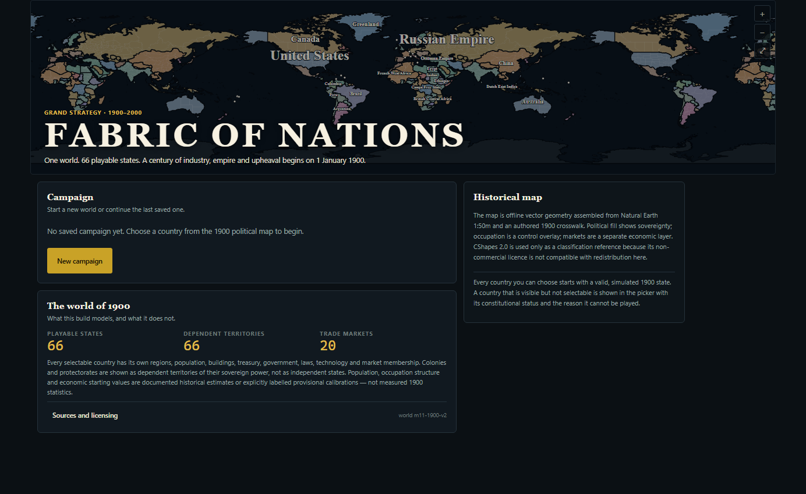
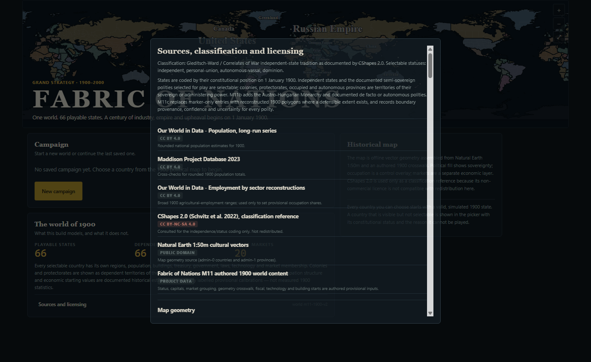
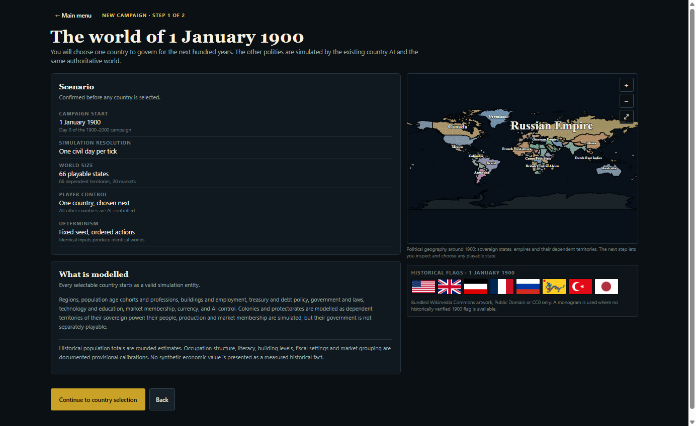
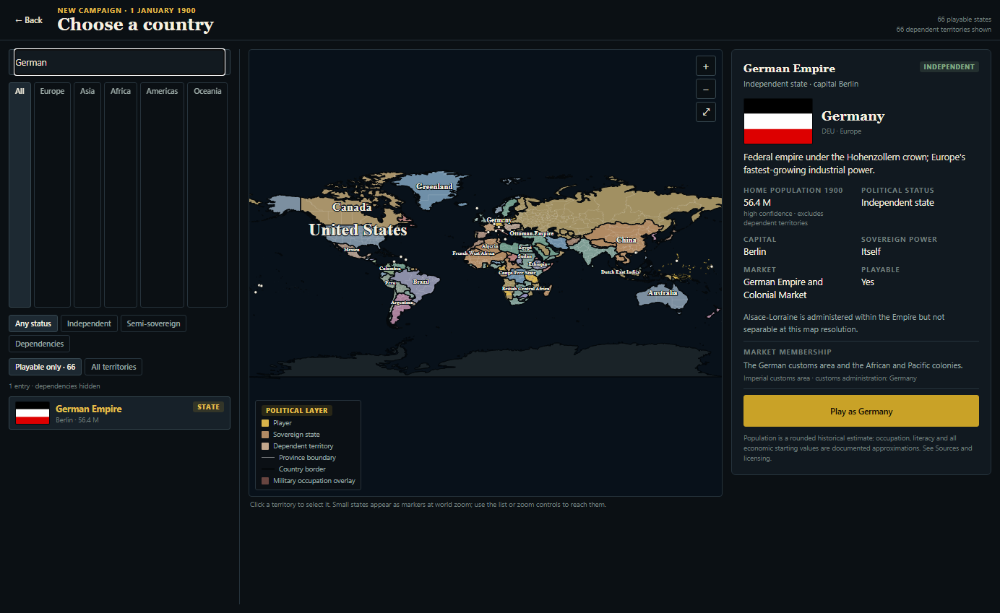
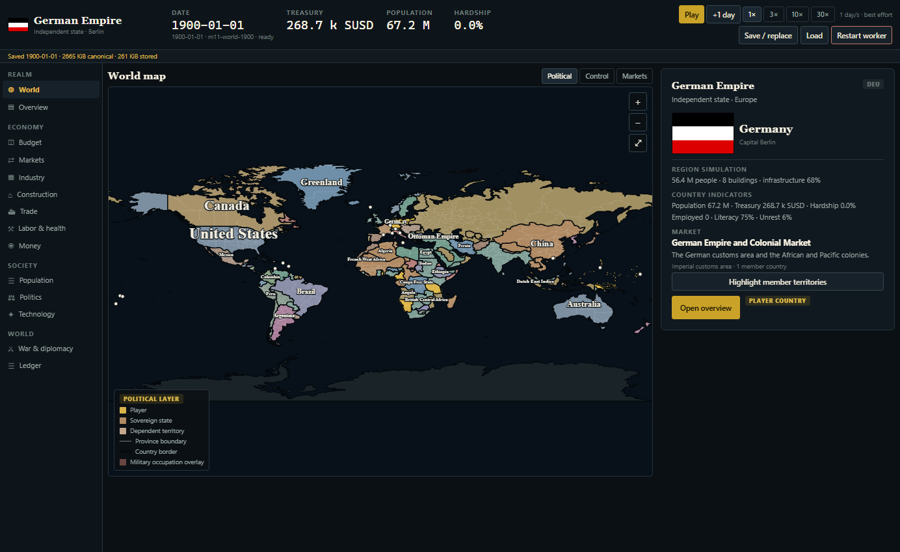
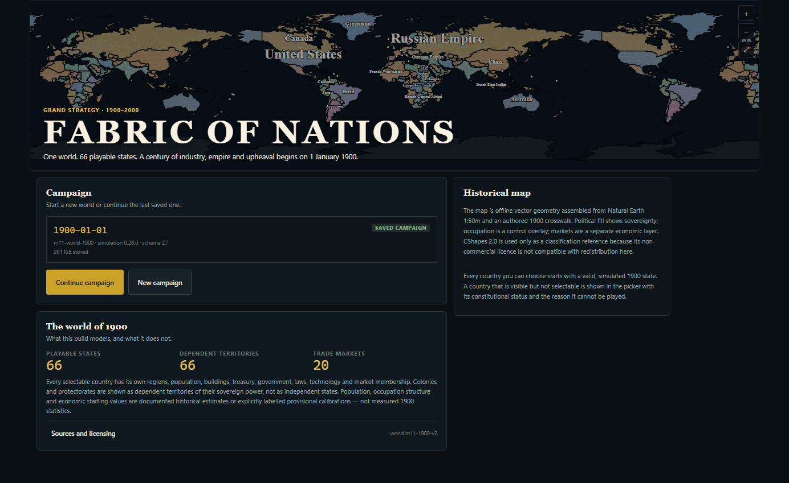
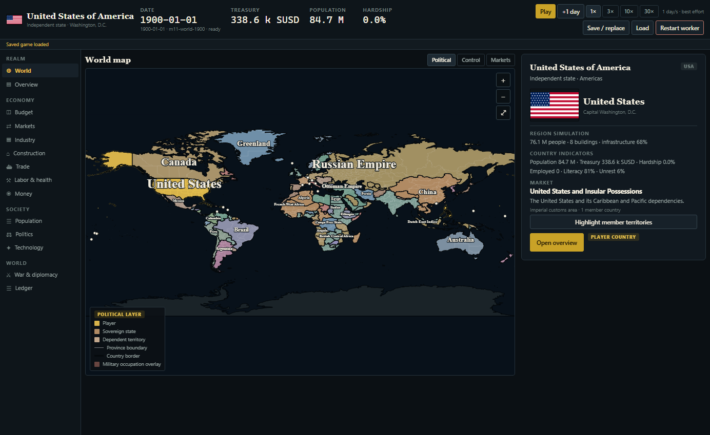
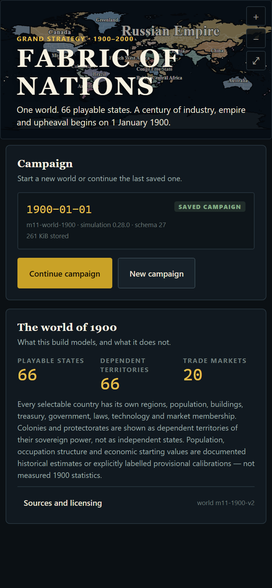

# M13 — Complete Game Rebranding: Century → Fabric of Nations

**Milestone:** M13 — complete game rebranding\
**Official name:** Fabric of Nations\
**Former name:** Century (retained only in historical documents and deliberate technical identifiers)\
**Date:** 2026-11-01\
**Status:** implemented and verified

---

## 1. Files modified and created

### Player-facing application and metadata

- `packages/app/app.json` — Expo name, slug, description, icon, iOS icon, Android adaptive icon, web name/short name/description/theme/background/display/start URL/scope.
- `packages/app/App.tsx` — loading-screen wordmark and Sources dialog attribution.
- `packages/app/src/screens/MainMenuScreen.tsx` — main-menu wordmark and responsive title typography.
- `packages/app/src/components/AppErrorBoundary.tsx` — current-name diagnostic log.
- `packages/app/src/theme.ts`, `packages/app/src/index.ts`, `packages/app/scripts/build-worker.mjs` — current-name comments/diagnostics.
- `packages/app/public/index.html` — browser title placeholder, manifest link, install metadata, dark document background.
- `packages/app/public/manifest.webmanifest` — PWA identity and icons.
- `packages/app/assets/favicon.png` — replaced the obsolete "C" favicon.
- `packages/app/assets/icon.png`, `packages/app/assets/adaptive-icon.png` — new application and Android adaptive icons.
- `packages/app/public/icons/icon-192.png`, `icon-512.png`, `maskable-512.png`, `apple-touch-icon.png` — PWA/install icons.
- `packages/app/package.json`, `packages/app/README.md` — current package description and shell documentation.
- `packages/app/src/generated/simWorker.ts` — regenerated after the scenario provenance text change.

### Generated content and content sources

- `packages/data/data/historical/m11/flags_1900.json`
- `packages/data/data/historical/m11/boundaries_1900.json`
- `packages/data/data/historical/m11/polities_1900.json`
- `packages/data/data/scenarios/m11_world_1900.json`
- `packages/data/data/scenarios/m5_eight_polities.json`
- `packages/data/data/map/world_map_1900.json`
- `packages/data/data/map/provinces_1900.json`
- `packages/data/data/map/provinces_asia_1900.json`
- `packages/data/data/map/provinces_africa_1900.json`
- `packages/data/data/map/provinces_americas_1900.json`
- `packages/data/data/map/provinces_oceania_1900.json`
- `packages/app/src/generated/worldCatalog.ts`
- `packages/app/src/generated/worldMap1900.ts`
- `packages/app/src/generated/flagProvenance.ts`
- `packages/app/src/generated/provinces1900.ts`
- `packages/app/src/generated/provincesAsia1900.ts`
- `packages/app/src/generated/provincesAfrica1900.ts`
- `packages/app/src/generated/provincesAmericas1900.ts`
- `packages/app/src/generated/provincesOceania1900.ts`
- `packages/sim-worker/src/generated/worldScenario.ts`

Only provenance/attribution strings changed. Simulation state, IDs, geometry, flag images, starting conditions, data version and schema version are unchanged.

### Generator and tooling sources

- `scripts/m11/build-flags.mjs`
- `scripts/m11/build-boundaries.mjs`
- `scripts/m11/boundaries-1900-source.mjs`
- `scripts/m11/build-world-data.mjs`
- `scripts/m12/province-plan.mjs`
- `scripts/m12b/asia-plan.mjs`
- `scripts/m12c/africa-plan.mjs`
- `scripts/m12d/americas-plan.mjs`
- `scripts/m12e/oceania-plan.mjs`
- `scripts/check-boundaries.mjs`
- `scripts/m11d/lib/harness.mjs` — optional `PLAYTEST_SHOT_DIR` and `.webmanifest` MIME support.
- `scripts/m11d/playtest.mjs`
- `scripts/m12/playtest-screenshot.mjs`
- `scripts/m12b/playtest-screenshot-asia.mjs`
- `scripts/m12c/playtest-screenshot-africa.mjs`
- `scripts/m12d/playtest-screenshot-americas.mjs`
- `scripts/m12e/playtest-screenshot-oceania.mjs`
- `scripts/m11e/verify-web-console.mjs`
- `scripts/m13/branding-audit.mjs` — new audit and metadata verifier.
- `scripts/m13/build-brand-assets.py` — new offline brand raster generator.
- `scripts/m13/playtest-rebrand.mjs` — new exported-web runtime verification.

### Documentation

- `README.md` — new title, former-name note, current GDD link, command table and CI description.
- `AGENTS.md` — official-name rule and current GDD path.
- `DECISIONS.md` — D-109 rebranding decision and retained identifiers.
- `Century_GDD_v2.18.md` → `Fabric_of_Nations_GDD.md` — current GDD renamed and retitled; GDD version 2.18 and v2.1–v2.17 historical files preserved.
- `.github/workflows/ci.yml` — branding audit step.
- `package.json` — `audit:branding` / `audit:branding:dist` scripts and CI inclusion.
- `docs/FLAG_PROVENANCE.md` — regenerated from the updated manifest.
- `docs/HISTORICAL_MAP_PROVENANCE.md`, `docs/HISTORICAL_DATA_PROVENANCE.md`, `docs/1900_CATALOG_COVERAGE.md`, `docs/randomness.md`.
- `docs/EUROPE_PROVINCIALIZATION.md`, `docs/ASIA_PROVINCIALIZATION.md`, `docs/AFRICA_PROVINCIALIZATION.md`, `docs/AMERICAS_PROVINCIALIZATION.md`, `docs/OCEANIA_PROVINCIALIZATION.md`.
- `docs/M11_DESIGN.md`, `docs/M11_REQUIREMENTS_MAP.md` — current GDD path.
- `packages/data/README.md`, `packages/sim-worker/README.md`, package descriptions in `packages/sim`, `packages/data`, `packages/sim-worker`, `packages/bench`, `packages/tests`.
- `docs/images/m13-brand-wordmark.png` — brand wordmark reference.

### Tests, fixtures and evidence

- `packages/tests/src/m13-branding.test.ts` — audit, player-facing identity and save-compatibility regressions.
- `packages/tests/src/fixtures/century-era-save.json` — compressed save produced before the rebrand.
- `docs/images/m13/*.png` — runtime verification screenshots.
- `docs/images/m13/runtime-check.json` — machine-readable runtime evidence.
- `docs/M13_REBRANDING_REPORT.md` — this report.

---

## 2. Player-facing branding changes

| Surface | New presentation |
|---|---|
| Main menu title | **FABRIC OF NATIONS**, brass serif display type over the 1900 map. Tagline still refers to "a century of industry" as a period of time. |
| Loading/splash screen | **FABRIC OF NATIONS** with the existing reading-world progress message. |
| New-game screen | No old wordmark; scenario description remains period-specific. |
| Country selection | No old wordmark; selected-country details unchanged. |
| Campaign interface | No old wordmark; top bar, map, tabs and save/load controls unchanged. |
| Pause control | The build has a pause/play control in the campaign top bar rather than a separate pause menu; it contains no old branding. |
| Settings | This build has no standalone Settings screen. No old branding exists in the screens that do exist. |
| Sources and Licensing dialog | Project-authored flags and authored 1900 content are attributed to **Fabric of Nations**. |
| Error messages | Error-boundary diagnostics use the current name. |
| Browser tab title | `Fabric of Nations`. |
| Browser install metadata | Manifest `name` and `short_name` are `Fabric of Nations`; standalone display, dark theme/background and PWA icons. |

The main menu, loading screen, new-game screen, country selection, campaign, sources dialog, save/load controls and browser metadata were all checked in the exported application.

---

## 3. Application metadata changes

`packages/app/app.json` now declares:

- `expo.name`: `Fabric of Nations`
- `expo.slug`: `fabric-of-nations`
- `expo.description`: historical 1900–2000 grand-strategy description
- `expo.icon`: `./assets/icon.png`
- `expo.ios.bundleIdentifier`: **`com.century.game` (retained)**
- `expo.android.package`: **`com.century.game` (retained)**
- Android adaptive icon foreground and `#0b1014` background
- `expo.web.name` / `shortName`: `Fabric of Nations`
- `expo.web.lang`: `en`
- `expo.web.themeColor` / `backgroundColor`: `#0b1014`
- `expo.web.display`: `standalone`
- `expo.web.startUrl` / `scope`: `/`

`public/index.html` supplies the document title placeholder, manifest link, application name, Apple mobile web app title and touch icon. `public/manifest.webmanifest` supplies the PWA identity. Expo's public-folder copy and template override were verified in the exported `dist-web/index.html` and `dist-web/manifest.webmanifest`.

**Native identifiers deliberately retained.** `com.century.game` is unchanged for iOS and Android. Changing it would create a new app-store identity and break update compatibility for installed builds; no reverse-domain organization identifier was invented. No URL scheme existed to update.

---

## 4. Icon and splash-screen changes

The old favicon was a plain brass **C** on an ink background (SHA-256 `5c98f7ead0d6df5934093b631ea565beb031a636908b1245dc55cd10ccbf542f`). It has been replaced.

The new identity retains the project's existing deep-ink `#0b1014`, brass `#e2bd4a`, parchment `#f7f1e1` and serif display language:

- 1024 × 1024 application icon: brass serif **F** inside inset brass/parchment frames.
- 1024 × 1024 Android adaptive foreground: transparent brass **F** inside a safe-zone ring.
- 512/192/maskable PWA icons and a 180 px Apple touch icon.
- Favicon source: the same typographic mark, downscaled by Expo to 16/32/48 px ICO.
- In-app splash/loading screen: full **FABRIC OF NATIONS** wordmark.
- Reference wordmark: `docs/images/m13-brand-wordmark.png`.


No native splash-image plugin is installed in this Expo SDK 58 project. The in-app loading screen carries the branded splash identity; native display metadata is configured through the application name and icon. No unrelated visual redesign was made.

---

## 5. Documentation updates

- Current GDD renamed to `Fabric_of_Nations_GDD.md`, title changed to **FABRIC OF NATIONS — GRAND STRATEGY 1900–2000**, GDD version kept at 2.18, and an M13 name note added.
- GDD v2.1–v2.17, all `GDD_V2.*_CHANGE_REPORT.md` files, all milestone completion reports, historical playtest reports and historical screenshots retain their original contents.
- `README.md` identifies Fabric of Nations as the game, explains the former name, links the current GDD, lists the branding-audit commands and documents CI coverage.
- `AGENTS.md` makes Fabric of Nations the official name for future agents and directs them to `Fabric_of_Nations_GDD.md`.
- `DECISIONS.md` adds D-109 covering player-facing, metadata, asset, save, internal-identifier, native-identifier and documentation decisions.
- Current provenance, provincialization, catalog-coverage and randomness documents use the new name.
- Package descriptions and READMEs use the new name; `@century/*` package names remain internal identifiers.

---

## 6. Internal identifiers deliberately retained

| Identifier | Reason retained |
|---|---|
| `@century/sim`, `@century/data`, `@century/sim-worker`, `@century/app`, `@century/bench`, `@century/tests` | Private workspace namespace and TypeScript imports; renaming churns every import and workspace dependency without player benefit. |
| Root private package `century` | Private workspace name; no distribution identity. |
| `century-save` envelope format and format version 1 | Canonical save format; changing it would invalidate existing saves. |
| `century-save-gzip1:` compressed-storage prefix | Existing browser/AsyncStorage representation. |
| `century.m7.save.v1`, `.previous`, `.staging` | Existing AsyncStorage keys; changing them would hide existing saves. |
| `runCentury`, `CenturyRoot`, `window.__centuryReceive` | Internal simulation/UI/worker bridge identifiers. |
| `com.century.game` (iOS bundle ID / Android package) | Installed-app and app-store update compatibility. |
| Historical GitHub path in the flag-audit user agent | Internal tooling metadata, not player-facing. |

`packages/sim` has no game-name string in its serialized authoritative state, and the save envelope has no branded field. No migration is therefore needed.

---

## 7. Save compatibility results

The rebranding did **not** change:

- save envelope format (`century-save`) or format version (`1`);
- world schema version (`27`);
- compression prefix or storage keys;
- simulation version or data version;
- polity IDs, province IDs, ownership/control records, historical starting conditions or tick behavior.

Evidence:

1. `packages/tests/src/fixtures/century-era-save.json` is a compressed save produced before the rebrand from the M11 1900 world (seed `20261023`, scenario `m11-world-1900`, schema 27, world hash `0c99bb73270294e5`). The M13 regression test decompresses it, reads its metadata, deserializes the world and reproduces the same world hash.
2. The runtime verification injects that same compressed save into the real browser `century.m7.save.v1` key, reloads the exported app, confirms the Continue card, loads the campaign and renders the world map.
3. Manual save and load from a newly created 1900 campaign also succeed in the exported app.
4. Existing save-store, serialization and determinism tests remain part of the full Jest suite.

---

## 8. Branding audit results

`pnpm run audit:branding` scans current application source, generated content, metadata, scripts, current documentation and package descriptions. It allows only explicitly documented internal identifiers and historical references, and it directly verifies application/PWA metadata, current GDD/README titles, icon presence/dimensions, the obsolete-favicon hash and the save-compatibility constants.

**Result:** passed.

```
Branding audit passed: 413 current files scanned, 3 internal identifier reference(s) and
33 historical reference(s) deliberately allowed.
```

`pnpm run audit:branding:dist` additionally verifies the exported browser title, manifest link, theme colour and copied PWA/icon assets.

**Result:** passed.

```
Branding audit passed: 413 current files scanned, 3 internal identifier reference(s) and
33 historical reference(s) deliberately allowed, exported web output verified.
```

The 33 historical allowances are predominantly `Century_GDD_v2.*.md` links in README/M11 records and the "formerly *Century*" notes in the README, AGENTS.md and current GDD. The three internal allowances are `CenturyRoot` (twice) and `runCentury`.

---

## 9. Runtime verification screenshots

Exported with `pnpm -F @century/app export:web`, served from `packages/app/dist-web`, and exercised in headless Chrome. The machine-readable evidence is `docs/images/m13/runtime-check.json` (35 checks, all passed; 0 console errors, 0 uncaught exceptions, 0 failed resource loads, 0 HTTP errors).

### Main menu and browser identity



### Sources and licensing



### New campaign



### Country selection



### Campaign initialization and map rendering


### Save and load




### Pre-rebrand save compatibility





### Narrow layout



The 390 px viewport wraps the wordmark onto two lines and reports no horizontal
overflow; the full name remains fully visible.

The exported `index.html` title is `Fabric of Nations`; the manifest link resolves to `/manifest.webmanifest`; manifest `name` and `short_name` are `Fabric of Nations`; favicon, 512 px PWA icon and Apple touch icon are served with HTTP 200.

---

## 10. Tests and their results

| Command | Result |
|---|---|
| `pnpm test` | PASS — 96 suites, 1,084 tests, 1,144 s (~19 min), including the M13 audit, player-facing identity and save-compatibility tests. |
| `pnpm typecheck` | PASS — all six workspace packages typechecked; `build:libs` succeeded. |
| `pnpm lint` | PASS — 241 TypeScript files, 66 in `packages/sim`. |
| `pnpm run check:worker` | PASS — worker scenario current; worker bundle current. |
| `pnpm run check:sim-deps` | PASS — 66 runtime modules, 0 cyclic components. |
| `pnpm flags:check` | PASS — 66 flags, 133 polities, 723,273 bytes. |
| `pnpm flags:audit` | PASS — 66 files re-verified against Wikimedia Commons licensing/author metadata. |
| `pnpm audit:branding` | PASS — current source/metadata audit. |
| `pnpm audit:branding:dist` | PASS — exported web output. |
| `pnpm -F @century/app export:web` | PASS — static export produced. |
| `node scripts/m13/playtest-rebrand.mjs` | PASS — 35 runtime checks. |

The full Jest run is a single long-running suite because `packages/tests` executes with `--runInBand`; the result above is recorded only after the run completed.

---

## 11. Remaining references to Century and why they remain

| Location | Reason |
|---|---|
| `Century_GDD_v2.1.md` … `Century_GDD_v2.17.md` | Archived historical GDD versions; contents and filenames preserved. |
| `GDD_V2.*_CHANGE_REPORT.md` | Historical change reports; original wording preserved. |
| `M12*_COMPLETION_REPORT.md`, `docs/M11D_PLAYTEST_REPORT.md`, `docs/M11E_RUNTIME_ERRORS_REPORT.md` | Historical milestone/playtest evidence. |
| `docs/images/m11d/*.png` | Historical screenshots showing the former UI title; preserved as evidence. New M13 screenshots document the rebranded build. |
| Historical entries in `DECISIONS.md` | Decision register preserves the wording of decisions made under the former name; D-109 records the rename. |
| `@century/*`, root package `century`, `runCentury`, `CenturyRoot`, `__centuryReceive` | Internal technical identifiers; retaining them avoids unnecessary churn. |
| `century-save`, `century-save-gzip1:`, `century.m7.save.v1*` | Save compatibility. |
| `com.century.game` | Native app identity and update compatibility. |
| `docs/M11_REQUIREMENTS_MAP.md` link to `Century_GDD_v2.17.md` | Historical GDD filename. |
| "century" as a period of time (lowercase) | Historical duration language, e.g. "a century of industry", "century-scale trends", not the game name. |

No obsolete Century wordmark appears in the main menu, loading screen, new-game flow, country selection, campaign shell, Sources and Licensing dialog, save/load UI, browser tab or install metadata.

---

## 12. Commit hash and working-tree status

- **HEAD at completion:** `2f7088f` (`fix: render continuous province and country borders`).
- **No new commit was created for M13.** The working tree already contained the
  uncommitted M12e provincial baseline (new province bundles, screenshots,
  completion reports and related edits) before M13 began. Committing only part of
  that baseline would leave the generated worker/scenario artifacts inconsistent,
  while committing all of it would fold the pending M12e milestone into the
  rebranding commit. Following the M12e convention, the changes are left for the
  designer's review.
- **Working-tree status:** dirty by design. `git status --porcelain` reports
  **246 entries** at completion: 78 modified/renamed tracked paths and 168
  untracked paths. These include the M12e baseline plus the M13 files listed in
  §1. Build products (`dist-web`, native export directories, caches and `*.log`)
  are ignored and are not part of the working-tree change set.
- **Post-verification changes:** after the full test/typecheck/worker/flags runs,
  only `docs/M13_REBRANDING_REPORT.md`, the M13 runtime screenshots/evidence, the
  playtest script's narrow-layout check, and the README link to this report were
  added or edited. No simulation, data, application source or generated artifact
  changed after the recorded verification runs. The branding audit was rerun
  after those documentation edits and still passes.

---

**End of report.**
