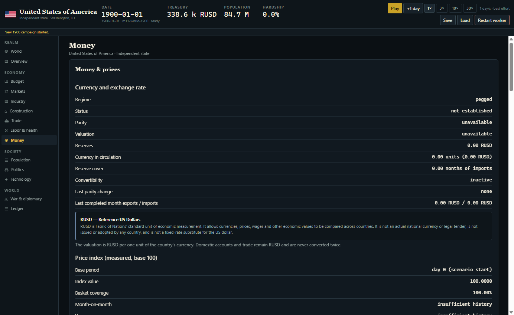
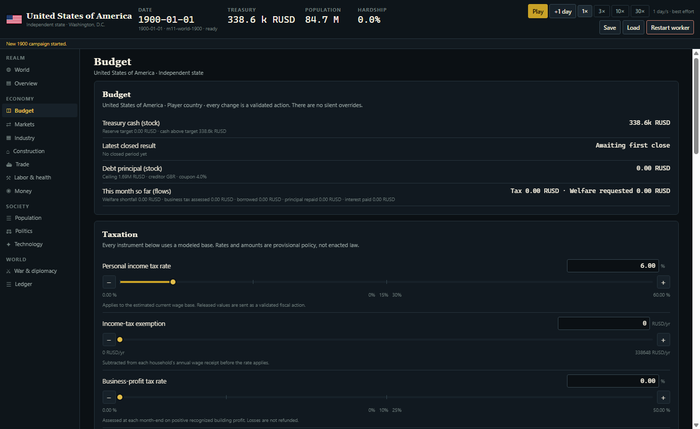
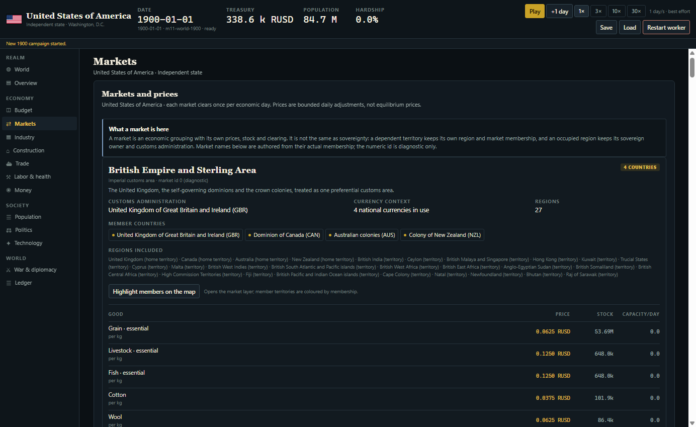
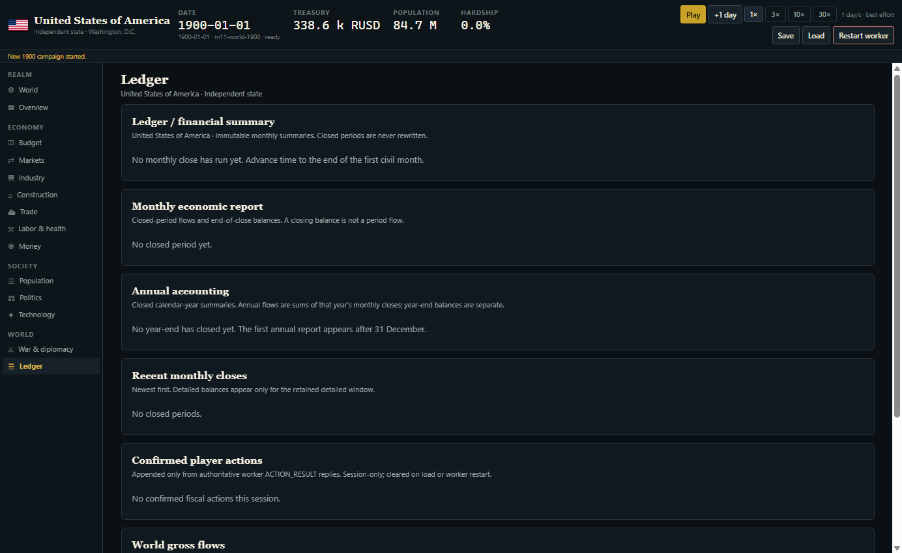
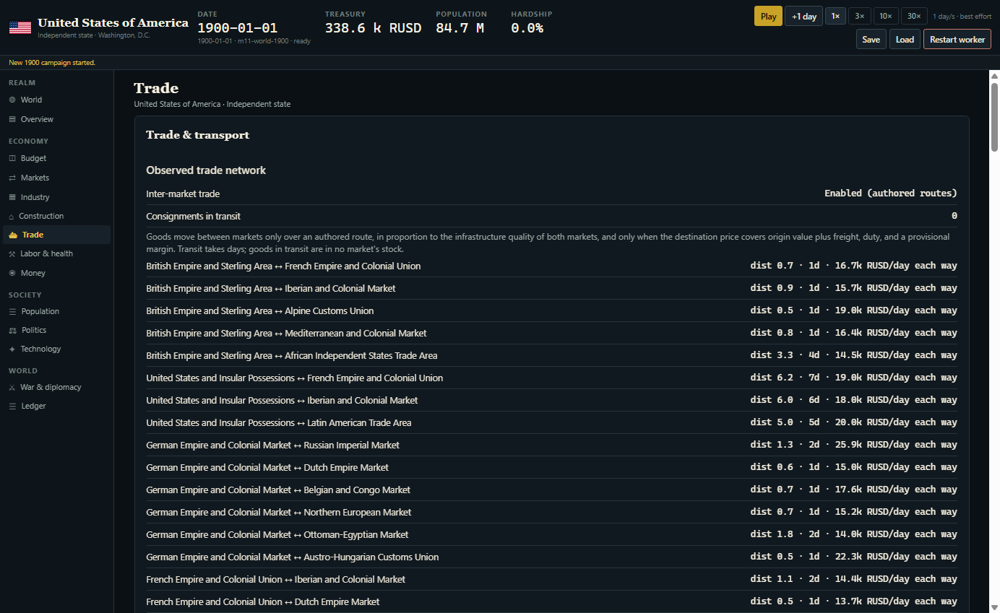
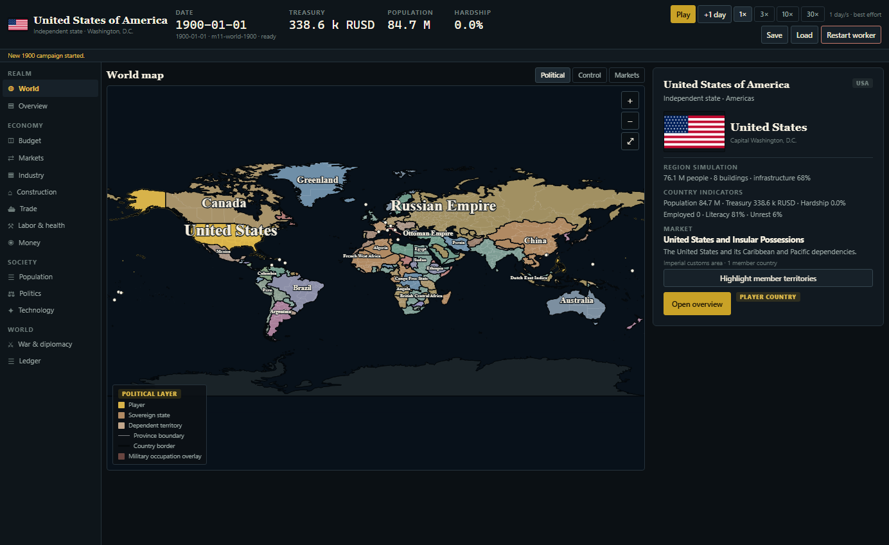

# M14 — Monetary Unit Renaming: SUSD → RUSD

**Milestone:** M14 — monetary terminology migration\
**Official unit:** RUSD — Reference US Dollars\
**Former unit:** SUSD — Simulated US Dollars (historical records and legacy save aliases only)\
**Date:** 2026-11-01\
**Status:** implemented and verified

---

## 1. Files modified and created

### Simulation and authoritative state

- `packages/sim/src/**` — all authoritative monetary identifiers, types, constants, validation messages, serialization fields and comments renamed from SUSD/Susd/susd to RUSD/Rusd/rusd.
- `packages/sim/src/constants.ts` — canonical `RUSD_CURRENCY_KEY`, `RUSD_UNIT_NAME`, `RUSD_UNIT_ABBREVIATION`, plus the documented `LEGACY_SUSD_CURRENCY_KEY` compatibility alias.
- `packages/sim/src/economy/country.ts` — rejects both `rusd` and the legacy `susd` spelling as national currency keys.
- `packages/sim/src/serialization.ts` — canonical RUSD field names plus `normalizeLegacyMonetaryKeys` for pre-M14 saves.
- `packages/sim/src/stateHash.ts` — documented legacy monetary vocabulary view for stable diagnostic hashes.
- `packages/sim/src/economy/accounts.ts` — historical opening-balance checksum vocabulary retained as a derived compatibility value.

### Data, worker and application

- `packages/data/data/**` — all authored JSON monetary keys, including `basePrice1900RUSD`, `balanceRUSD`, `initialTreasuryCashRUSD`, `rusdPerUnit`, `priceRUSD`, `baseCapacityRUSDPerDay` and the historical country/pop/building/trade data.
- `packages/data/src/historical.ts` — loader/validator identifiers and legacy reserved-key rejection.
- `packages/sim-worker/src/**` — protocol, snapshot builder, previews, selectors, reports, explanations and action history renamed; `PROTOCOL_VERSION` bumped from 15 to 16 for the changed snapshot vocabulary.
- `packages/app/src/**` — all economic screens, formatting calls, labels, units and monetary explanations.
- `packages/app/src/screens/MoneyScreen.tsx` — player explanation of RUSD and its non-currency status.
- `packages/app/src/generated/worldCatalog.ts`, `packages/app/src/generated/simWorker.ts`, `packages/sim-worker/src/generated/worldScenario.ts` — regenerated current artifacts.
- `packages/bench/src/**` — benchmark identifiers, labels and reports.

### Tests and tooling

- `packages/tests/src/**` — all monetary test identifiers and expected labels migrated.
- `packages/tests/src/m14-rusd.test.ts` — new canonical identity, USD distinction, non-currency, monetary-equivalence, legacy-save, canonical-save, determinism and audit tests.
- `packages/tests/src/m4a2-country-currency.test.ts` — reserved-key test now covers RUSD and the legacy SUSD spelling.
- `scripts/**` — current generator/data script identifiers updated.
- `scripts/m14/monetary-terminology-audit.mjs` — new automated terminology audit.
- `package.json`, `.github/workflows/ci.yml` — `audit:monetary` script and CI step.
- `docs/M14_RUSD_RENAMING_REPORT.md` — this report.

### Documentation

- `Fabric_of_Nations_GDD.md` — all current unit terminology, definition and non-currency explanation.
- `README.md` — current unit rule, former-term note, command table and M14 report link.
- `AGENTS.md` — official RUSD rule and the USD/RUSD distinction.
- `DECISIONS.md` — D-110, the M14 terminology and compatibility decision.
- Current data source notes and `docs/M11_SLIDER_INVENTORY.md` monetary terminology.
- Historical GDDs, change reports, completion reports, requirements maps, M11D/M11E reports and the M13 report are unchanged.

---

## 2. Source-code terminology changes

The migration covered, in the real implementation:

- money types (`MoneyRUSD`), branded rate types (`RusdPerCurrencyUnit`, `asRusdPerCurrencyUnit`) and constants (`RUSD_CURRENCY_KEY`, `RUSD_PER_*`, `*_RUSD`, `*_RUSD_PER_YEAR`);
- state fields (`balanceRUSD`, `priceRUSD`, `initialSavingsRUSD`, `initialTreasuryCashRUSD`, `treasuryCashRUSD`, `debtLiabilityRUSD`, `netFiscalResultRUSD`, `parityRusdPerUnit`, `valuationRusdPerUnit`, `reserveCashRUSD`, `liabilityRUSD`, and the full finance, trade, construction, industrial, labor, technology, monetary, military and province-related monetary surface);
- functions (`formatRUSD`, `asRusdPerCurrencyUnit`, preview and report builders);
- validation messages, comments, test fixtures, benchmark labels and snapshot fields;
- all authored JSON monetary keys and the loaders that validate them.

`USD` itself was not renamed. Real national currency keys in the 1900 catalog (`usd`, `gbp`, `frf`, etc.) remain unchanged.

---

## 3. Player-facing UI changes

- Every monetary label, table, chart, tooltip and input now uses `RUSD`.
- The established suffix convention is retained: `1,000.00 RUSD`, `1.0k RUSD`, `RUSD/unit`.
- The Money screen now contains an information entry:

> **RUSD — Reference US Dollars.** RUSD is Fabric of Nations' standard unit of economic measurement. It allows currencies, prices, wages and other economic values to be compared across countries. It is not an actual national currency or legal tender, is not issued or adopted by any country, and is not a fixed-rate substitute for the US dollar.

- Country overview, budget, ledger, markets, trade, industry, construction, labor, population, technology, politics, diplomacy/war and monetary screens were checked for SUSD leakage.

---

## 4. GDD and documentation updates

- The current GDD defines RUSD as **Reference US Dollars**, a neutral measurement unit, and explicitly states that it is not issued by any country, not legal tender, not adoptable, and not a fixed USD/RUSD rate.
- README's measurement rule and former-unit note were updated.
- `AGENTS.md` now makes RUSD the official unit and forbids reintroducing SUSD into current code or documentation.
- `DECISIONS.md` D-110 records the rename, semantics, compatibility aliases and save decisions.
- Historical documents retain their original SUSD wording. They are not rewritten to make the rename retroactive.

---

## 5. Monetary identifiers and constants renamed

Examples of the real renames:

| Before | After |
|---|---|
| `SUSD` | `RUSD` |
| `susd`, `Susd` | `rusd`, `Rusd` |
| `MoneySUSD` | `MoneyRUSD` |
| `SusdPerCurrencyUnit` | `RusdPerCurrencyUnit` |
| `asSusdPerCurrencyUnit` | `asRusdPerCurrencyUnit` |
| `SUSD_CURRENCY_KEY` | `RUSD_CURRENCY_KEY` |
| `formatSUSD` | `formatRUSD` |
| `balanceSUSD` | `balanceRUSD` |
| `priceSUSD` | `priceRUSD` |
| `basePrice1900SUSD` | `basePrice1900RUSD` |
| `initialTreasuryCashSUSD` | `initialTreasuryCashRUSD` |
| `paritySusdPerUnit` | `parityRusdPerUnit` |
| `MONEY_TOLERANCE_SUSD` | `MONEY_TOLERANCE_RUSD` |

No numeric literal, scale, tolerance, calibration target or conversion formula changed.

---

## 6. Legacy identifiers deliberately retained

| Identifier | Purpose |
|---|---|
| `LEGACY_SUSD_CURRENCY_KEY = "susd"` | Rejects the old reserved spelling as a national currency; documents the former unit. |
| `normalizeLegacyMonetaryKeys` in `serialization.ts` | Translates pre-M14 `SUSD`/`Susd`/`susd` save keys to RUSD after checksum verification. |
| `legacyMonetaryView` in `stateHash.ts` | Stable diagnostic hash vocabulary; no economic semantics. |
| `balanceSUSD` mapping in the opening-balance checksum | Keeps historical opening checksums and hashes stable for unchanged balances. |
| Historical GDDs, change reports, completion reports, requirements maps, M11D/M11E reports and M13 report | Historical records; original SUSD wording preserved. |
| `DECISIONS.md` entries before D-110 | Historical decision record; original wording preserved. |

---

## 7. Save compatibility and migration results

The save envelope format (`century-save`), format version (`1`), world schema (`27`), simulation version (`0.28.0`) and data version (`m3-economy-v12`) are unchanged.

- The checksum is verified against the **raw** payload, so pre-M14 checksums remain valid.
- After checksum verification, `normalizeLegacyMonetaryKeys` recursively translates legacy SUSD/Susd/susd object keys to RUSD while leaving numeric values, arrays and string values untouched.
- New saves serialize only RUSD field names and compute their checksum over that canonical payload.
- The pre-M14 compressed fixture `packages/tests/src/fixtures/century-era-save.json` loads successfully, retains schema 27 and reproduces its historical world hash `0c99bb73270294e5`.
- New RUSD saves round-trip to the identical canonical string and world hash.
- Mixed legacy/current spelling for the same key is rejected as ambiguous.

No schema migration, numeric conversion or value rewrite is performed.

---

## 8. Numerical equivalence verification

The pre-M14 code was checked out into a temporary worktree and used to emit the same M3 world under the old vocabulary. After vocabulary normalization, the encoded payload and all numeric values matched the current RUSD payload; the only historical difference was the vocabulary string itself and the derived opening-balance checksum, which is now deliberately computed with the historical spelling to preserve compatibility. The pre-M14 M3 structural digest `cbdb84df3c7ff849` and the 1900 world digest `0c99bb73270294e5` both still reproduce exactly.

The M14 test creates the 1900 world from `loadM11World()` with seed `20261023` and asserts:

- `hashWorld` is still `0c99bb73270294e5`;
- account balances, opening-balance records, market prices and currency valuations are identical to the pre-M14 save;
- no monetary value changed.

---

## 9. Determinism verification

- `hashWorld` keeps the historical SUSD vocabulary view over the RUSD-encoded state, so existing known-answer hashes and benchmark digests remain valid.
- The canonical save checksum uses RUSD directly; save round-trips are byte-identical.
- The opening-balance checksum uses its historical field spelling for unchanged balances, preserving the historical world hash.
- No RNG purpose, seed, tick phase or iteration order changed.
- The full determinism/serialization test set remains part of `pnpm test`.

---

## 10. Monetary terminology audit results

`pnpm run audit:monetary` scans current source, data, snapshots, UI, current docs and the current GDD. It allows only documented legacy aliases and historical files.

Result: **PASS — 412 current files scanned, 68 documented legacy alias
reference(s) and 4 historical reference(s) deliberately allowed.**

It also verifies the canonical constants, the presence of real `usd` in the 1900 data without registering the reference unit as a country currency, the Money-screen explanation, RUSD serialization fields, the legacy save normalizer, the hash compatibility view, the save format and the worker protocol version.

---

## 11. Runtime playtest results

The exported web application is exercised by `scripts/m14/playtest-rusd.mjs` (RUSD-specific checks added to the existing runtime harness). It checks the browser title, main menu, new campaign, country selection, campaign initialization, and the monetary screens for consistent RUSD labels, no SUSD, and no console errors.

**Result:** PASS — 27 runtime checks; 0 console errors, 0 uncaught exceptions,
0 failed resource loads. The check visited the main menu, the United States
campaign, Money, Budget, Markets, Ledger, Trade and Overview screens, and
save/load across the protocol-16 worker boundary. Every visited screen displays
RUSD and none displays SUSD.

Screenshots: `docs/images/m14/` (main menu, campaign, Money, Budget, Markets,
Ledger, Trade, Overview, loaded campaign). Machine-readable evidence:
`docs/images/m14/runtime-check.json`.

### Money screen

### Budget

### Markets

### Ledger

### Trade

### Campaign top bar

---

## 12. All tests and their results

| Command | Result |
|---|---|
| `pnpm test` | PASS — 97 suites, 1,095 tests, 1,300 s (~22 min), including the M14 terminology, USD distinction, legacy save, canonical RUSD save and monetary-equivalence tests. |
| `pnpm typecheck` | PASS |
| `pnpm lint` | PASS |
| `pnpm run check:worker` | PASS |
| `pnpm run check:sim-deps` | PASS |
| `pnpm flags:check` | PASS |
| `pnpm flags:audit` | PASS |
| `pnpm audit:branding` | PASS |
| `pnpm audit:monetary` | PASS |
| `pnpm -F @century/app export:web` | PASS |
| M14 runtime playtest | PASS — 27 checks, 0 console errors. |

---

## 13. Remaining SUSD references and why they remain

| Location | Reason |
|---|---|
| Historical `Century_GDD_v2.*.md` | Archived GDD versions; original SUSD terminology preserved. |
| `GDD_V2.*_CHANGE_REPORT.md`, `M*_COMPLETION_REPORT.md` | Historical milestone reports; not rewritten. |
| `docs/*_REQUIREMENTS_MAP.md`, `docs/M11D_PLAYTEST_REPORT.md`, `docs/M11E_RUNTIME_ERRORS_REPORT.md` | Historical milestone evidence. |
| `docs/M13_REBRANDING_REPORT.md` | Historical rebranding report. |
| `DECISIONS.md` entries before D-110 | Historical decision register. |
| Legacy save aliases and hash/checksum compatibility code | Required to load pre-M14 saves and preserve historical deterministic hashes. |
| Historical screenshots | Evidence of the former UI; new M14 screenshots document the current build. |

No obsolete SUSD term appears in current player-facing code, current generated data, the current GDD or current UI.

---

## 14. Commit hashes and working-tree status

- **HEAD at completion:** `2f7088f` (`fix: render continuous province and country borders`).
- **No new commit was created for M14.** The working tree already contained the
  uncommitted M12e provincial baseline and M13 rebranding changes. Committing only
  part of that baseline would leave generated worker/scenario artifacts
  inconsistent; committing all of it would fold the pending milestones into the
  terminology commit. Following the M12e/M13 convention, the changes are left for
  the designer's review.
- **Working-tree status:** dirty by design. `git status --porcelain` reports
  **415 entries** at completion: 243 modified/renamed tracked paths and 172
  untracked paths. These include the M12e/M13 baseline plus the M14 files listed
  in §1. Build products, temporary comparison worktrees, caches and `*.log`
  files are excluded.
- **Post-verification changes:** after the full test/typecheck/worker/flag/audit
  runs, only this report, the M14 screenshots/evidence and documentation wording
  were added or edited. No simulation, data, application source or generated
  artifact changed after the recorded verification runs.

---

**End of report.**
